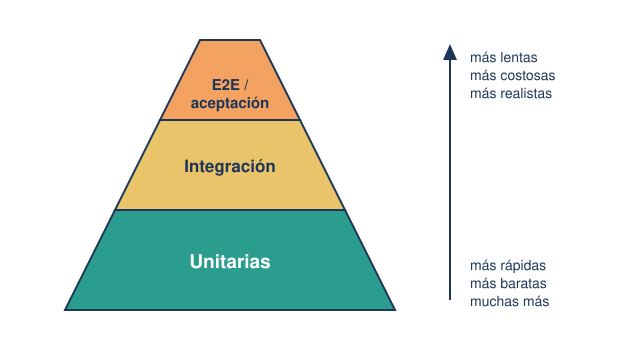

# 🧠 ¿Qué probar y por qué? · Conceptos

## La idea en una frase
Una prueba automatizada es código que ejecuta tu código y **te avisa sin que tengas que mirar** cuando deja de hacer lo que prometía.

Piénsala como una alarma de humo: no apaga el incendio, pero avisa a tiempo. Y una alarma sin pila es peor que no tener alarma, porque te da una tranquilidad falsa. Este camino trata sobre pruebas que de verdad pueden sonar.

## Para qué sirven
- **Feedback rápido.** Sabes en segundos si un cambio rompió algo, no días después por un reporte de un usuario.
- **Cambiar sin miedo.** Con una buena red de pruebas puedes reorganizar el código (refactorizar) y comprobar que todo sigue funcionando.
- **Documentación que no miente.** Una prueba muestra cómo se usa el código y qué se espera de él, y si queda desactualizada, falla.
- **Mejor diseño.** El código difícil de probar suele estar demasiado acoplado (hace muchas cosas, depende de todo). Escribir la prueba lo revela temprano.

## La pirámide de pruebas
No todas las pruebas cuestan lo mismo. Mira cómo cambian la velocidad y el costo según el nivel:



| Nivel | Qué prueba | Velocidad | Cuando falla, te dice… |
|---|---|---|---|
| **Unitaria** | Una función o clase, aislada | Milisegundos | Exactamente qué pieza se rompió |
| **Integración** | Varias piezas juntas o una pieza con algo real (un archivo, una base de datos) | Segundos | Que las piezas no encajan |
| **Extremo a extremo / aceptación** | El sistema completo, como lo usa una persona (la línea de comandos, la API) | Segundos a minutos | Que algo, en algún lugar, no cumple lo prometido |

La forma de pirámide es una guía, no una ley: muchas pruebas rápidas abajo y pocas lentas arriba. En el proyecto del bloque escribirás de los dos extremos: unitarias para la lógica y de aceptación que ejecutan la línea de comandos como lo haría una persona.

## Anatomía de una prueba: Arrange, Act, Assert
Casi toda prueba tiene tres partes: preparar, actuar y comprobar.

```python
def test_discount_applies_from_100():
    cart = Cart()                      # Arrange: prepara el escenario
    cart.add("teclado", 100)

    total = cart.total()               # Act: ejecuta lo que quieres probar

    assert total == 90                 # Assert: comprueba el resultado
```

En pytest, una prueba es una función cuyo nombre empieza con `test_`, dentro de un archivo `test_*.py`, y comprueba con un `assert` normal de Python. Si quieres decirlo en lenguaje de negocio, es lo mismo que *Dado* (Given) / *Cuando* (When) / *Entonces* (Then).

## Qué hace buena a una prueba
| Propiedad | Significa | Si falta… |
|---|---|---|
| **Rápida** | Corre en milisegundos | No la corres seguido, y deja de avisar a tiempo |
| **Aislada** | No depende de otras pruebas ni de su orden | Falla o pasa según qué corrió antes (lab 1.5) |
| **Repetible** | Da el mismo resultado hoy, mañana y en otra máquina | No sabes si falló tu código o el reloj, la red o el azar |
| **Auto-verificable** | Dice sola si pasó o falló, sin que leas nada | Alguien tiene que interpretar la salida, y nadie lo hará |
| **Enfocada y legible** | Prueba una idea, y su nombre la dice | Cuando falla, no sabes qué se rompió |

Se suele resumir con la sigla en inglés *FIRST* (Fast, Isolated, Repeatable, Self-validating, Timely); la última significa que la escribes cuando escribes el código, no meses después.

## La prueba que pasa por la razón equivocada
Este es el concepto central del camino. Una prueba en verde solo vale si **podía ponerse roja**. Mira este archivo: la función `total` tiene un bug (multiplica por 2), y aun así pytest dice que todo está bien.

```python
def total(prices):
    return sum(prices) * 2  # bug: debería ser sum(prices)


def check_total():  # sin el prefijo test_: pytest nunca la ejecuta
    assert total([1, 2]) == 3


def test_every_item_positive():
    items = []  # imagina una consulta que no devolvió nada
    for item in items:
        assert item > 0  # nunca se ejecuta


def test_runs_but_checks_nothing():
    total([1, 2])  # ejecuta el código, pero no comprueba nada
```

```text
test_wrong_reason.py::test_every_item_positive PASSED                    [ 50%]
test_wrong_reason.py::test_runs_but_checks_nothing PASSED                [100%]

============================== 2 passed in 0.01s ==============================
```

Tres trampas en un solo archivo:
1. **La prueba que nunca corre.** `check_total` no empieza con `test_`, así que pytest no la recolecta. Fíjate en la salida: solo hay 2 pruebas. Y si un archivo no tiene ninguna, pytest dice `no tests ran` y termina con el código de salida 5.
2. **La prueba que pasa porque no hay nada que revisar.** El `for` sobre una lista vacía no ejecuta ningún `assert`.
3. **La prueba sin comprobación.** Ejecuta el código pero no verifica nada; solo fallaría si el código lanzara una excepción.

La defensa es una regla simple: **ve fallar cada prueba al menos una vez.** Escríbela, rompe a propósito el código que prueba (o escribe la prueba antes que el código) y confirma que se pone roja. Si nunca la viste en rojo, no sabes si puede ponerse roja.

Ese "romper a propósito" tiene nombre: un **mutante** es una copia del código con un bug pequeño sembrado (un `>=` cambiado por `>`, un `+` por `-`). Una buena suite de pruebas **mata** a los mutantes: falla contra ellos. Desde el lab 1.2 tus pruebas se validan así, con una caza de mutantes.

## Qué probar (y qué no)
- **Prueba el comportamiento, no los detalles internos.** "Con 100 de compra hay descuento" es comportamiento; "la función llama a `_apply_rule` dos veces" es un detalle que puede cambiar sin que nada se rompa.
- **Prueba los límites.** Los bugs viven en los bordes: 0, vacío, el valor exacto del umbral, el máximo.
- **Prueba los errores.** Qué pasa con una entrada inválida es parte del contrato.
- **No pruebes lo que no es tuyo.** No hace falta comprobar que `sorted` de Python ordena; sí que tu código lo usa bien.
- **La cobertura no es la meta.** Que una línea se ejecute en una prueba no significa que se compruebe (lo verás en el lab 1.5).

## Fuentes
- [Martin Fowler · TestPyramid](https://martinfowler.com/bliki/TestPyramid.html): el origen y los matices de la pirámide.
- [Ham Vocke · The Practical Test Pyramid](https://martinfowler.com/articles/practical-test-pyramid.html): la pirámide aplicada, con ejemplos.
- [pytest · Good Integration Practices](https://docs.pytest.org/en/stable/explanation/goodpractices.html): cómo descubre pytest las pruebas y cómo organizarlas.
- [pytest · Changing standard test discovery](https://docs.pytest.org/en/stable/example/pythoncollection.html): reglas de nombres (`test_*.py`, `test_*`).
- [pytest · Exit codes](https://docs.pytest.org/en/stable/reference/exit-codes.html): el código 5 cuando no se recolectó ninguna prueba.
