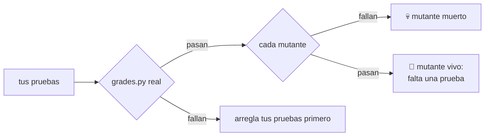

# 🧩 1.2 · Primeras pruebas

| ⏱️ Duración | 🧪 Tipo | 🏷️ Tipo de tema | 🛠️ Stack |
|---|---|---|---|
| 1–2 h | 🧩 `challenge` | 🎯 `core` | Python 3.12+ · pytest 9.2 |

## 🎯 Objetivos
- Escribir pruebas que pytest descubre y ejecuta, usando un `assert` normal de Python.
- Comparar números decimales con `pytest.approx` y explicar por qué hace falta.
- Probar que el código lanza un error con `pytest.raises`, incluido el mensaje.
- Elegir casos en los límites (el valor exacto del umbral, los empates).
- Leer un fallo de pytest y seleccionar qué pruebas correr (`-k`, `-x`, `-v`).
- Ver tus pruebas fallar por la razón correcta: matar mutantes.

## 💡 Por qué importa
Todo lo demás (fixtures, parametrización, cobertura) se construye sobre esto: una prueba que comprueba lo correcto en el caso correcto. Y la mitad de los bugs vive en los bordes: el `>=` que alguien escribió como `>`, la lista vacía, el empate que nadie probó.

## 📍 Dónde correr los comandos
Activa el entorno virtual (ver [SETUP.md](../../../SETUP.md)) y abre una terminal **dentro de la carpeta `starter/` de este lab**. Comprueba dónde estás:

PowerShell:

```powershell
Get-Location
```

Bash:

```bash
pwd
```

> [!NOTE]
> Usa siempre `python -m pytest` y no solo `pytest`: así corre el pytest de tu entorno virtual, con la carpeta actual en la ruta de importación.

## 🧠 Conceptos
- **Descubrimiento:** pytest ejecuta las funciones `test_*` de los archivos `test_*.py` (repasa la trampa de la prueba que nunca corre en el [lab 1.1](../01-why-test/CONCEPT.md)).
- **`assert` con introspección:** cuando un `assert` falla, pytest muestra los valores de cada lado, sin que escribas mensajes.
- **`pytest.approx`:** compara números decimales con una tolerancia, porque `0.1 + 0.2` no es exactamente `0.3` en binario.
- **`pytest.raises`:** comprueba que un bloque lanza una excepción; `match` revisa el mensaje con una **expresión regular**.
- **Mutante:** una copia del código con un bug sembrado. Tus pruebas lo matan si fallan contra él.

## 📚 Documentación
- [How to write and report assertions in tests](https://docs.pytest.org/en/stable/how-to/assert.html)
- [`pytest.approx`](https://docs.pytest.org/en/stable/reference/reference.html#pytest-approx) y [`pytest.raises`](https://docs.pytest.org/en/stable/reference/reference.html#pytest-raises)
- [How to invoke pytest](https://docs.pytest.org/en/stable/how-to/usage.html) (`-k`, `-x`, `-v`)

## 🧭 Escenario
[`grades.py`](starter/grades.py) ya funciona: calcula notas de un curso en escala de 0 a 100. **No lo cambies.** Tu trabajo está en [`tests/test_grades.py`](starter/tests/test_grades.py), que trae seis pruebas que todavía solo dicen `pytest.skip("TODO …")`.

| Función | Promete |
|---|---|
| `average(grades)` | El promedio. Lista vacía → `ValueError`. Una nota fuera de 0–100 → `ValueError("grade out of range [0, 100]: …")` |
| `passed(grade)` | `True` si la nota llega a 60. **El 60 aprueba.** |
| `ranking(students)` | Nombres de la mejor nota a la peor; **los empates, en orden alfabético** |

¿Cómo sabemos si tus pruebas son buenas? Con la **caza de mutantes** ([`tests/test_mutant_hunt.py`](starter/tests/test_mutant_hunt.py)). Corre tus pruebas dos veces: con el `grades.py` real (deben pasar) y con cada mutante de [`tests/mutants/`](starter/tests/mutants/) (deben fallar). Un mutante que sobrevive es un bug que tus pruebas dejarían pasar.



| Mutante | Bug sembrado | Lo mata la tarea |
|---|---|---|
| `m1-integer-division` | El promedio usa `//` en vez de `/` | 1 |
| `m2-empty-returns-zero` | `average([])` devuelve `0.0` en vez de lanzar el error | 2 |
| `m3-no-range-check` | Acepta notas hasta 1000 | 2 |
| `m4-strict-boundary` | `passed` usa `>` en vez de `>=` | 3 |
| `m5-ties-insertion-order` | Los empates quedan en el orden en que llegaron | 4 |

> [!TIP]
> Intenta no abrir los mutantes: la tabla basta. Si te trabas, abrir uno es una pista legítima.

## ✅ Tareas

Corre todo así (tus pruebas y la caza):

PowerShell:

```powershell
python -m pytest
```

Bash:

```bash
python -m pytest
```

### Tarea 1 · El promedio
**Meta:** comprobar `average` con valores enteros y decimales. **La valida:** `test_your_tests_catch[m1-integer-division]`.

- [ ] En `test_average_of_several_grades`, comprueba el promedio de `[70, 85, 90]`.
- [ ] En `test_average_of_decimal_grades`, comprueba que el promedio de `[0.1, 0.2]` es `0.15`.

🔮 **Predice primero:** ¿pasará `assert average([0.1, 0.2]) == 0.15`? Escríbelo, córrelo y lee el fallo.

```powershell
python -m pytest tests/test_grades.py
```

> [!WARNING]
> Comparar decimales con `==` es una trampa clásica. Mira bien el número que muestra pytest.

### Tarea 2 · Los errores
**Meta:** comprobar que la entrada inválida lanza `ValueError`. **La validan:** `[m2-empty-returns-zero]` y `[m3-no-range-check]`.

- [ ] En `test_average_of_no_grades_is_an_error`, usa `with pytest.raises(ValueError):` alrededor de `average([])`.
- [ ] En `test_grade_out_of_range_is_an_error`, comprueba que `average([90, 120])` lanza `ValueError` **y que el mensaje contiene `out of range [0, 100]`**.

🔮 **Predice primero:** ¿pasará `pytest.raises(ValueError, match="out of range [0, 100]")`?

> [!WARNING]
> `match` no compara texto: busca una expresión regular. Los corchetes tienen un significado especial.

### Tarea 3 · El límite
**Meta:** comprobar el borde exacto de `passed`. **La valida:** `[m4-strict-boundary]`.

- [ ] En `test_the_passing_grade_itself_passes`, comprueba que 60 aprueba y que una nota apenas menor no.

🔮 **Predice primero:** si escribes las dos comprobaciones, `assert passed(60)` y `assert not passed(59.9)`, ¿cuál de ellas mata al mutante m4?

### Tarea 4 · Los empates
**Meta:** comprobar que los empates salen en orden alfabético. **La valida:** `[m5-ties-insertion-order]`.

- [ ] En `test_ties_are_in_alphabetical_order`, arma un diccionario con dos estudiantes empatados y uno con mejor nota, y comprueba el resultado de `ranking`.

🔮 **Predice primero:** si escribes los empatados en orden alfabético (`{"ana": 90, "beto": 95, "zoe": 90}`), ¿muere el mutante m5?

> [!WARNING]
> Una prueba puede pasar con el código real y también con el bug si los datos no permiten distinguirlos.

**Criterio de éxito:** `python -m pytest` dentro de `starter/` termina en verde: 12 pruebas pasan, ninguna se salta.

## 🔍 Disección de comandos
| Comando | Qué hace |
|---|---|
| `python -m pytest` | Corre las pruebas de `testpaths` (aquí, `tests/`) con el Python del entorno activo |
| `python -m pytest tests/test_grades.py` | Solo ese archivo: tus pruebas, sin la caza |
| `python -m pytest tests/test_grades.py::test_average_of_several_grades` | Una sola prueba |
| `-v` | Una línea por prueba con su resultado (`PASSED`, `FAILED`, `SKIPPED`) |
| `-q` | Salida mínima |
| `-k ties` | Solo las pruebas cuyo nombre o ID contiene `ties`; incluye `[m5-ties-insertion-order]` de la caza |
| `-x` | Se detiene en el primer fallo |
| `--tb=short` | Trazas de error más cortas |

## 👀 Qué deberías ver
Al empezar, con el starter tal cual:

```text
FAILED tests/test_mutant_hunt.py::test_your_tests_catch[m1-integer-division]
FAILED tests/test_mutant_hunt.py::test_your_tests_catch[m2-empty-returns-zero]
FAILED tests/test_mutant_hunt.py::test_your_tests_catch[m3-no-range-check] - ...
FAILED tests/test_mutant_hunt.py::test_your_tests_catch[m4-strict-boundary]
FAILED tests/test_mutant_hunt.py::test_your_tests_catch[m5-ties-insertion-order]
=================== 5 failed, 1 passed, 6 skipped in 2.24s ====================
```

La prueba que ya pasa es `test_your_tests_pass_against_the_real_code`: unas pruebas que se saltan no fallan contra el código real, pero tampoco matan a nadie. Cada tarea que resuelvas pone en verde sus mutantes.

## 💼 En proyectos reales
- **Nombra las pruebas por el comportamiento** (`test_the_passing_grade_itself_passes`), no por la función (`test_passed_2`): cuando falla en el CI, el nombre ya dice qué se rompió.
- **`approx` es para medidas, no para dinero.** Con montos se usa `Decimal` y se compara exacto; lo harás en el proyecto del bloque.
- **Escapa el texto en `match`** con `re.escape(...)` o busca un fragmento sin caracteres especiales.
- **Los mutantes no son solo de este curso:** existen herramientas de *mutation testing* que los generan solas a partir de tu código, como [mutmut](https://pypi.org/project/mutmut/). Son lentas para correrlas en cada cambio, pero muy útiles para auditar una suite.
- **El bug más caro es el que la prueba deja pasar.** Ante cada prueba pregúntate: ¿qué bug atrapa?

## 🚀 Reto extra
Escribe tu propio mutante: copia `grades.py` en `tests/mutants/m6-<nombre>/`, siembra un bug que tus pruebas actuales **no** atrapen (pista: el promedio de una sola nota, o una nota exactamente en 0 o en 100) y agrega la prueba que lo mata. La caza lo detecta solo.

## 🆘 Pistas
<details><summary>Pista 1 · dirección</summary>

Cada tarea es una prueba de tres líneas o menos. Si no sabes qué valor esperar, calcúlalo a mano antes de escribir el `assert`.
</details>

<details><summary>Pista 2 · más concreta</summary>

- Tarea 1: `assert average([0.1, 0.2]) == pytest.approx(0.15)`.
- Tarea 2: `with pytest.raises(ValueError, match=re.escape("out of range [0, 100]")):` (el `import re` ya está arriba).
- Tarea 4: escribe los empatados en orden **no** alfabético en el diccionario.
</details>

## ✔️ Respuestas verificadas
<details><summary>Ábrelas solo después de terminar las tareas</summary>

Todo esto se ejecutó con Python 3.12 y pytest 9.2.0.

**Tarea 1.** No pasa: el promedio real es `0.15000000000000002`.

```text
E   assert 0.15000000000000002 == 0.15
E    +  where 0.15000000000000002 = average([0.1, 0.2])
```

`pytest.approx(0.15)` acepta una diferencia relativa muy pequeña y la prueba pasa.

**Tarea 2.** No pasa: `[0, 100]` es una clase de caracteres ("un 0, una coma, un espacio o un 1"), no el texto literal.

```text
E   AssertionError: Regex pattern did not match.
E     Expected regex: 'out of range [0, 100]'
E     Actual message: 'grade out of range [0, 100]: 120'
```

**Tarea 3.** Solo `assert passed(60)` mata a m4. Con el mutante, `passed(60)` es `False` (falla, mutante muerto), pero `not passed(59.9)` sigue siendo `True`, porque 59.9 no aprueba con `>` ni con `>=`. La segunda línea igual vale: protege el otro lado del límite.

**Tarea 4.** No muere. Con `{"ana": 90, "beto": 95, "zoe": 90}` el orden de llegada ya es alfabético, así que el código real y el mutante devuelven lo mismo:

```text
E       AssertionError: Mutant 'm5-ties-insertion-order' survived: your tests still pass when grades.py has this bug.
```

Escribe los empatados al revés (`{"zoe": 90, "beto": 95, "ana": 90}`) y el mutante muere.
</details>

## 🎤 Autoevaluación
1. ¿Por qué `0.1 + 0.2 == 0.3` es `False` en Python, y cuándo usarías `approx` en vez de `Decimal`?
2. Una compañera escribe `pytest.raises(ValueError, match="cost: $10")` y la prueba falla aunque el mensaje es exactamente ese. ¿Qué pasa y cómo lo arreglas?
3. ¿Qué es un mutante, y qué te dice que uno sobreviva a tu suite?
4. Tienes un umbral `>= 18`. ¿Qué valores probarías y por qué esos?
5. Una prueba pasa con el código real y también con el bug. ¿Cómo diseñas los datos para que distinga los dos?

La solución completa está en [`solution/`](solution/).

## 🔁 Retrospectiva
- ¿Qué entendí?
- ¿Qué me costó?
- ¿Qué debería reforzar?
