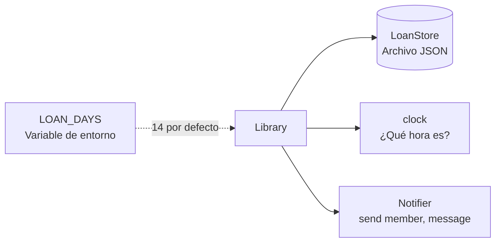

# 🧩 1.4 · Fixtures y dobles de prueba

| ⏱️ Duración | 🧪 Tipo | 🏷️ Tipo de tema | 🛠️ Stack |
|---|---|---|---|
| 1,5–2 h | 🧩 `challenge` | 🎯 `core` | Python 3.12+ · pytest 9.2 |

## 🎯 Objetivos
- Escribir fixtures en `conftest.py` y combinarlas (una fixture que usa otras).
- Elegir el `scope` de una fixture y explicar por qué casi siempre es el de función.
- Probar código que escribe archivos usando `tmp_path`, sin dejar basura ni estado entre pruebas.
- Controlar el tiempo con un reloj falso inyectado, en lugar de esperar o depender de la hora real.
- Reemplazar una dependencia por un doble con `create_autospec` y comprobar cómo se llamó.
- Cambiar variables de entorno solo durante una prueba con `monkeypatch`.

## 💡 Por qué importa
El código real escribe archivos, mira la hora y habla con otros sistemas: envía correos, llama a APIs. Probarlo "tal cual" da pruebas lentas, que fallan según el día y que mandan correos de verdad. Las fixtures y los dobles te dejan probar todo eso en milisegundos y de forma repetible.

## 📍 Dónde correr los comandos
Con el entorno virtual activo, abre una terminal **dentro de la carpeta `starter/` de este lab**:

PowerShell:

```powershell
Get-Location
```

Bash:

```bash
pwd
```

## 🧠 Conceptos
- **Fixture:** una función decorada con `@pytest.fixture` que prepara algo para una prueba. La prueba la pide **por nombre**, como parámetro, y pytest se la entrega. Las fixtures pueden pedir otras fixtures.
- **`conftest.py`:** el lugar para las fixtures compartidas. pytest lo carga solo, sin `import`.
- **`scope`:** cuánto vive una fixture. `function` (el valor por defecto) crea una nueva para cada prueba; `module` o `session` la comparten, y con ella su estado.
- **`tmp_path`:** fixture de pytest que da una carpeta temporal nueva para cada prueba.
- **Inyección de dependencias:** `Library` recibe su almacén, su reloj y su notificador en lugar de crearlos. Por eso se pueden reemplazar en las pruebas.
- **Dobles de prueba:** un **fake** es una implementación simple que funciona de verdad (el `FakeClock`); un **mock** registra cómo lo llamaron para que la prueba lo compruebe. `create_autospec` hace un mock que solo acepta lo que la clase real tiene.
- **`monkeypatch`:** cambia variables de entorno, atributos o diccionarios durante una prueba y los **restaura** al terminar.
- **`capsys`:** fixture de pytest que captura lo que el código imprime; `capsys.readouterr()` devuelve `.out` y `.err`. La usarás en el proyecto del bloque para probar una línea de comandos.

## 📚 Documentación
- [How to use fixtures](https://docs.pytest.org/en/stable/how-to/fixtures.html) y [fixture scopes](https://docs.pytest.org/en/stable/how-to/fixtures.html#scope-sharing-fixtures-across-classes-modules-packages-or-session)
- [How to use temporary directories and files](https://docs.pytest.org/en/stable/how-to/tmp_path.html)
- [How to monkeypatch/mock modules and environments](https://docs.pytest.org/en/stable/how-to/monkeypatch.html)
- [`unittest.mock`: autospeccing](https://docs.python.org/3/library/unittest.mock.html#autospeccing)
- [Martin Fowler · Mocks Aren't Stubs](https://martinfowler.com/articles/mocksArentStubs.html)

## 🧭 Escenario
[`loans.py`](starter/loans.py) ya funciona: los préstamos de una biblioteca. **No lo cambies.**



| Método | Promete |
|---|---|
| `lend(book, member)` | Guarda el préstamo en el archivo. Un libro ya prestado → `ValueError("already lent: …")` |
| `overdue()` | Los préstamos con **más** días que el plazo. El último día todavía no es atraso |
| `send_reminders()` | Un aviso por préstamo atrasado, con `notifier.send(member, "Please return '<book>'")`; devuelve cuántos envió |
| `loan_days()` | El plazo: `LOAN_DAYS` del entorno, o 14 |

En [`tests/conftest.py`](starter/tests/conftest.py) ya están la parte de la caza (no la toques) y un `FakeClock` escrito. Tus pruebas van en [`tests/test_loans.py`](starter/tests/test_loans.py). La caza es la del lab 1.2:

| Mutante | Bug sembrado | Lo mata la tarea |
|---|---|---|
| `m1-save-is-noop` | `save()` no escribe nada | 1 |
| `m2-double-lending-allowed` | Se puede prestar un libro ya prestado | 1 |
| `m3-last-day-is-late` | El último día ya cuenta como atraso (`>=`) | 2 |
| `m4-ignores-the-clock` | `overdue()` usa la hora real (`datetime.now()`) y no el reloj inyectado | 2 |
| `m5-reminds-everyone` | Avisa a todos, atrasados o no | 3 |
| `m6-calls-a-missing-method` | Llama a `notifier.send_message(...)`, que no existe | 3 |
| `m7-ignores-the-environment` | El plazo siempre es 14, diga lo que diga `LOAN_DAYS` | 4 |

## ✅ Tareas

```powershell
python -m pytest
```

### Tarea 1 · Las fixtures y un archivo temporal
**Meta:** preparar el escenario una vez y reutilizarlo en todas las pruebas. **La validan:** `[m1-save-is-noop]` y `[m2-double-lending-allowed]`.

- [ ] En `conftest.py`, escribe cuatro fixtures:
  - `clock`: devuelve un `FakeClock(datetime(2026, 1, 15, 9, 0))`;
  - `notifier`: `create_autospec(Notifier, instance=True)`;
  - `store`: un `LoanStore` sobre `tmp_path / "loans.json"`;
  - `library`: pide las otras tres y arma la `Library`.
- [ ] En `test_a_loan_is_saved_to_the_file(library, tmp_path)`: presta un libro y léelo con un `LoanStore` **nuevo** sobre el mismo archivo (dentro de una misma prueba, `tmp_path` es la misma carpeta que recibió `store`).
- [ ] En `test_a_book_cannot_be_lent_twice(library)`: el segundo préstamo del mismo libro lanza `ValueError`.

🔮 **Predice primero:** el archivo es el mismo para todas las pruebas, ¿así que conviene que `store` sea `scope="module"` para crearlo una sola vez? Pruébalo.


### Tarea 2 · Un reloj que controla la prueba
**Meta:** probar el límite del plazo sin esperar 14 días. **La validan:** `[m3-last-day-is-late]` y `[m4-ignores-the-clock]`.

- [ ] En `test_a_loan_is_not_overdue_on_its_last_day`: presta un libro, avanza el reloj **exactamente** 14 días (`clock.advance(days=14)`) y comprueba que **no** está atrasado.
- [ ] En `test_a_loan_is_overdue_after_its_last_day`: avanza 14 días y 1 segundo y comprueba que sí lo está.

🔮 **Predice primero:** ¿cuál de las dos pruebas mata al mutante que usa la hora real?

### Tarea 3 · Un doble del notificador
**Meta:** comprobar a quién se avisó, sin enviar nada de verdad. **La validan:** `[m5-reminds-everyone]` y `[m6-calls-a-missing-method]`.

- [ ] Presta `"Dune"` a `"ana"`, avanza 10 días, presta `"Emma"` a `"beto"` y avanza 5 más: el primero está atrasado y el segundo no.
- [ ] Comprueba que `send_reminders()` devuelve 1 **y** que el notificador recibió exactamente ese aviso: `notifier.send.assert_called_once_with("ana", "Please return 'Dune'")`.

🔮 **Predice primero:** si solo compruebas que `send_reminders()` devuelve 1, ¿qué mutantes sobreviven? ¿Y si además el doble fuera un `Mock()` sin `spec`?

### Tarea 4 · Variables de entorno con `monkeypatch`
**Meta:** probar que el plazo se lee del entorno, sin afectar a otras pruebas. **La valida:** `[m7-ignores-the-environment]`.

- [ ] Pide la fixture `monkeypatch` y usa `monkeypatch.setenv("LOAN_DAYS", "7")`.
- [ ] Presta un libro, avanza 8 días y comprueba que está atrasado.

🔮 **Predice primero:** ¿qué pasaría si en lugar de `monkeypatch` escribieras `os.environ["LOAN_DAYS"] = "7"`?

**Criterio de éxito:** `python -m pytest` en `starter/` termina en verde: 14 pruebas pasan.

## 🔍 Disección de comandos
| Código | Qué hace |
|---|---|
| `@pytest.fixture` | Convierte la función en una fixture; su nombre es el que piden las pruebas |
| `@pytest.fixture(scope="module")` | Una sola instancia para todo el archivo (con su estado compartido) |
| `def library(store, clock, notifier):` | Una fixture que pide otras: pytest resuelve el árbol |
| `tmp_path` | Una carpeta temporal nueva para cada prueba (`pathlib.Path`) |
| `create_autospec(Notifier, instance=True)` | Un mock con la forma de un objeto `Notifier`: solo acepta sus métodos y argumentos |
| `mock.send.assert_called_once_with(a, b)` | Falla si `send` no se llamó exactamente una vez con esos argumentos |
| `monkeypatch.setenv("X", "7")` | Pone `X=7` solo durante la prueba |

## 👀 Qué deberías ver
Con el starter tal cual:

```text
7 failed, 1 passed, 6 skipped
```

Pasa el guardián; fallan los 7 mutantes; tus 6 pruebas se saltan.

## 💼 En proyectos reales
- **Inyecta lo que cambia** (hora, archivos, red, servicios externos). Si el código crea sus dependencias adentro (`datetime.now()`, `smtplib.SMTP(...)`), tendrás que hacer `monkeypatch` de módulos, que es frágil. Si las recibe, la prueba simplemente le pasa otras.
- **`scope` más amplio solo para lo caro e inmutable** (por ejemplo, levantar un contenedor de base de datos una vez por sesión). Lo que guarda estado, por función.
- **Prefiere fakes para comportamiento, mocks para interacciones.** El `FakeClock` funciona de verdad; el mock del notificador sirve para preguntar "¿a quién avisaste?".
- **Siempre con `spec`/`autospec`.** Un `Mock()` desnudo acepta cualquier método, así que un error de nombre pasa las pruebas y explota en producción.
- **Aísla el entorno de la máquina:** si alguien tiene `LOAN_DAYS` definida en su terminal, las pruebas del plazo de 14 días fallarían solo en su equipo. Una fixture `autouse=True` con `monkeypatch.delenv("LOAN_DAYS", raising=False)` lo evita.

## 🚀 Reto extra
Escribe un `FakeNotifier` (un fake: guarda los avisos en una lista) y reescribe la prueba de la tarea 3 con él en lugar del mock. ¿Qué mutantes mata? ¿Qué prueba te parece más legible?

## 🆘 Pistas
<details><summary>Pista 1 · dirección</summary>

Una fixture es solo una función que devuelve algo: `def clock(): return FakeClock(...)`. Para que `library` reciba las otras, ponlas como parámetros: `def library(store, clock, notifier):`.
</details>

<details><summary>Pista 2 · más concreta</summary>

```python
@pytest.fixture
def store(tmp_path):
    return LoanStore(tmp_path / "loans.json")
```

Tarea 3: arma los dos préstamos con 10 días de diferencia y avanza 5 más; así uno tiene 15 días (atrasado) y el otro 5.
</details>

## ✔️ Respuestas verificadas
<details><summary>Ábrelas solo después de terminar las tareas</summary>

Todo esto se ejecutó con Python 3.12 y pytest 9.2.0.

**Tarea 1.** `scope="module"` con `tmp_path` ni siquiera arranca: `tmp_path` vive por función y no puede alimentar algo que vive más.

```text
ScopeMismatch: You tried to access the function scoped fixture tmp_path with a module scoped request object.
```

Y con una ruta fija (`Path("loans.json")`) el archivo se comparte entre pruebas **y entre corridas**. La primera corrida da `5 failed, 1 passed`; la segunda, `6 failed`, todas con:

```text
E   ValueError: already lent: Dune
```

**Tarea 2.** La prueba del último día. Sola, mata a `m3` y a `m4`; la de "un segundo después", sola, no mata a ninguno. Con el reloj falso en el 29 de enero de 2026, el mutante usa la hora real (meses después) y ve un atraso donde no lo hay; un segundo después del plazo, el código real y el mutante dicen lo mismo ("atrasado"). Más adelante, la prueba de la tarea 3 también atrapa a `m4`, porque depende del reloj: una suite completa suele matar a un mutante por más de un lado.

**Tarea 3.** Si solo compruebas el número devuelto, `m5-reminds-everyone` sobrevive siempre: devuelve 1 aunque avise a dos personas. Con un `Mock()` sin `spec` también sobrevive `m6-calls-a-missing-method`, porque el mock acepta `send_message` sin quejarse. Con `create_autospec`, `m6` muere:

```text
E   AttributeError: Mock object has no attribute 'send_message'
```

Para matar a `m5` hace falta preguntarle al doble: `assert_called_once_with`.

**Tarea 4.** `os.environ["LOAN_DAYS"] = "7"` deja la variable puesta para todo lo que corre después. En este archivo, la prueba del entorno es la última, así que tus pruebas pasan… pero la caza corre después y sus procesos heredan `LOAN_DAYS=7`. Contra el código real, la prueba del último día falla, el guardián se pone rojo y bloquea a los 7 mutantes:

```text
E   AssertionError: Your tests must pass against the real loans.py before they can catch mutants.
      1 failed, 5 passed in 0.09s
```

Y si la prueba del entorno corriera **antes** que las del reloj, rompería directamente la del último día. `monkeypatch.setenv` la restaura al terminar la prueba. Que una prueba falle según qué corrió antes es el tema del lab 1.5.
</details>

## 🎤 Autoevaluación
1. ¿Qué gana `Library` al recibir el reloj como parámetro en lugar de llamar a `datetime.now()`?
2. ¿Cuándo usarías una fixture con `scope="session"` y qué riesgo tiene?
3. ¿En qué se diferencian un fake y un mock? Da un ejemplo de cuándo prefieres cada uno.
4. ¿Por qué un `Mock()` sin `spec` puede dejar pasar un bug de producción?
5. Una prueba falla solo cuando corres la suite completa, y pasa sola. ¿Qué sospechas primero?

La solución completa está en [`solution/`](solution/).

## 🔁 Retrospectiva
- ¿Qué entendí?
- ¿Qué me costó?
- ¿Qué debería reforzar?

**Siguiente:** [1.5 · Cobertura y pruebas inestables](../05-coverage-flaky/README.md)
