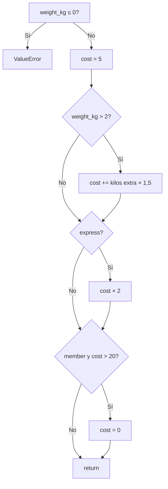

# 🔭 1.5 · Cobertura y pruebas inestables

| ⏱️ Duración | 🧪 Tipo | 🏷️ Tipo de tema | 🛠️ Stack |
|---|---|---|---|
| 1–1,5 h | 🔭 `exploration` | 🎯 `core` | Python 3.12+ · pytest 9.2 · pytest-cov 7.1 |

## 🎯 Objetivos
- Medir la cobertura de líneas y de ramas con pytest-cov y leer el reporte de líneas y ramas faltantes.
- Explicar por qué un 100% de cobertura no garantiza que las pruebas comprueben algo.
- Reconocer y reproducir una prueba que depende del orden y otra que depende del azar del hash.
- Usar `--lf` y `--durations` para trabajar con fallos y pruebas lentas (y conocer `--sw`).

## 💡 Por qué importa
"Tenemos 100% de cobertura" es una de las frases más tranquilizadoras y más engañosas de un equipo. Y una prueba que falla "a veces" es peor que una que falla siempre: el equipo aprende a reintentarla hasta que pase y deja de creerle a la suite. Este lab te enseña a medir la cobertura con criterio y a cazar la inestabilidad en lugar de reintentar.

## 📍 Dónde correr los comandos
Con el entorno virtual activo, abre una terminal **dentro de la carpeta `demo/` de este lab**:

PowerShell:

```powershell
Get-Location
```

Bash:

```bash
pwd
```

## 🧠 Conceptos
- **Cobertura de líneas:** qué porcentaje de las líneas se **ejecutó** durante las pruebas. Mide ejecución, no comprobación.
- **Cobertura de ramas:** si cada decisión (`if`) tomó **sus dos caminos**. Una línea `if` ejecutada no dice si alguna vez fue falsa.
- **Prueba inestable (*flaky*):** pasa o falla sin que cambie el código. Las causas típicas son el estado compartido entre pruebas, el orden, el tiempo, el azar, la red o el orden de un `set` o un `dict` armado de forma no determinista.
- **`PYTHONHASHSEED`:** Python mezcla los hashes de los textos con una semilla al azar en cada proceso, así que el orden de un `set` de textos puede cambiar entre corridas. Fijar la semilla lo hace reproducible.

## 📚 Documentación
- [pytest-cov: reporting](https://pytest-cov.readthedocs.io/en/latest/reporting.html)
- [coverage.py: branch coverage](https://coverage.readthedocs.io/en/latest/branch.html)
- [pytest: flaky tests](https://docs.pytest.org/en/stable/explanation/flaky.html)
- [pytest: cache (`--lf`, `--ff`, `--sw`)](https://docs.pytest.org/en/stable/how-to/cache.html)
- [Python: `PYTHONHASHSEED`](https://docs.python.org/3/using/cmdline.html#envvar-PYTHONHASHSEED)

## 🧭 Escenario
La `demo/` está terminada y funciona. No hay nada que completar: vas a medirla y a romperla a propósito.

| Archivo | Qué es |
|---|---|
| [`shipping.py`](demo/shipping.py) | Costo de envío: base de 5, más 1,5 por cada kilo sobre 2; el exprés cuesta el doble; los miembros no pagan si el costo pasa de 20 |
| [`tests/test_shipping.py`](demo/tests/test_shipping.py) | Tres pruebas que pasan. `python -m pytest` corre solo esta carpeta |
| [`experiments/`](demo/experiments/) | Pruebas inestables o lentas, a propósito. Solo se corren cuando las nombras |



## 🧪 Experimentos

### Experimento 1 · La cobertura de líneas
🔮 **Predice primero:** con solo tres pruebas, ¿qué porcentaje de las líneas de `shipping.py` crees que se ejecuta?

PowerShell:

```powershell
python -m pytest --cov=shipping --cov-report=term-missing
```

Bash:

```bash
python -m pytest --cov=shipping --cov-report=term-missing
```

<details><summary>👀 Qué deberías ver</summary>

```text
Name          Stmts   Miss  Cover   Missing
shipping.py      14      0   100%
TOTAL            14      0   100%
```

Todas las líneas se ejecutan. ¿Significa que todo está probado? Los siguientes experimentos responden.
</details>

### Experimento 2 · La cobertura de ramas
🔮 **Predice primero:** si además pides la cobertura de ramas, ¿seguirá en 100%? Si no, ¿qué caso falta?

```powershell
python -m pytest --cov=shipping --cov-branch --cov-report=term-missing
```

<details><summary>👀 Qué deberías ver</summary>

```text
Name          Stmts   Miss Branch BrPart  Cover   Missing
shipping.py      14      0      8      1    95%   12->14
```

`12->14` es un camino que nunca se tomó: de la línea 12 (`if weight_kg > 2:`) directo a la 14. Es decir, el `if` nunca fue falso: **ninguna prueba manda un paquete de 2 kg o menos.** Todas las líneas se ejecutan, pero un caso entero (el más común en la vida real) no está probado.
</details>

### Experimento 3 · 100% de cobertura con un bug vivo
🔮 **Predice primero:** en `shipping.py`, cambia `cost *= 2` por `cost *= 3`, como si el exprés costara el triple por error. ¿Falla alguna prueba? ¿Cambia la cobertura?

```powershell
python -m pytest --cov=shipping --cov-report=term-missing
```

<details><summary>👀 Qué deberías ver</summary>

```text
TOTAL            14      0   100%
============================== 3 passed in 0.05s ==============================
```

Todo verde y 100% de cobertura con el bug puesto. La única prueba con exprés es la de un miembro que termina **gratis**: el costo da 0 con `× 2` y con `× 3`, así que la línea se ejecuta pero su efecto nunca se comprueba. Es el mismo problema que la caza de mutantes de los labs 1.2 a 1.4 hace visible.
</details>

> [!IMPORTANT]
> **Vuelve a dejar `cost *= 2`** antes de seguir (o `git restore shipping.py`).

### Experimento 4 · Pasa en grupo, falla sola
🔮 **Predice primero:** [`experiments/test_order.py`](demo/experiments/test_order.py) tiene dos pruebas que comparten una lista. ¿Pasan juntas? ¿Y la segunda sola?

```powershell
python -m pytest experiments/test_order.py
python -m pytest experiments/test_order.py -k one_item
```

Después, corre solo lo que falló la última vez:

```powershell
python -m pytest experiments/test_order.py --lf
```

<details><summary>👀 Qué deberías ver</summary>

Juntas, `2 passed`. La segunda sola:

```text
E       assert 0 == 1
FAILED experiments/test_order.py::test_the_cart_has_one_item - assert 0 == 1
======================= 1 failed, 1 deselected in 0.05s =======================
```

Con `--lf`:

```text
run-last-failure: rerun previous 1 failure
FAILED experiments/test_order.py::test_the_cart_has_one_item - assert 0 == 1
```

Sola vuelve a fallar: el fallo no es "mala suerte", depende de qué corrió antes. Esa es la pista para buscar estado compartido (una variable de módulo, un archivo, una variable de entorno: recuerda la trampa de `os.environ` del lab 1.4).
</details>

### Experimento 5 · El azar del hash
🔮 **Predice primero:** [`experiments/test_hash_order.py`](demo/experiments/test_hash_order.py) compara `list(set(...))` con una lista fija. Córrela seis veces seguidas. ¿Da siempre lo mismo?

```powershell
python -m pytest experiments/test_hash_order.py
```

Ahora fija la semilla del hash, primero en `0` y luego en `2`:

PowerShell:

```powershell
$env:PYTHONHASHSEED = "0"; python -m pytest experiments/test_hash_order.py
$env:PYTHONHASHSEED = "2"; python -m pytest experiments/test_hash_order.py
Remove-Item Env:PYTHONHASHSEED
```

Bash:

```bash
PYTHONHASHSEED=0 python -m pytest experiments/test_hash_order.py
PYTHONHASHSEED=2 python -m pytest experiments/test_hash_order.py
```

<details><summary>👀 Qué deberías ver</summary>

Con Python 3.12 (en otra versión las semillas que fallan pueden ser otras, pero siempre habrá unas que pasan y otras que fallan):

```text
E         At index 1 diff: 'testing' != 'pytest'
FAILED experiments/test_hash_order.py::test_unique_tags - AssertionError: ass...
============================== 1 failed in 0.05s ==============================
============================== 1 passed in 0.01s ==============================
```

Sin semilla fija, cada corrida sortea el orden. Fijarla no arregla la prueba: la vuelve **reproducible** para poder estudiarla. El arreglo real es no depender del orden: comparar con `sorted(...)` o con un `set`.
</details>

### Experimento 6 · ¿Cuál es la lenta?

```powershell
python -m pytest experiments/test_durations.py --durations=3
```

```text
============================= slowest 3 durations =============================
0.60s call     experiments/test_durations.py::test_slow
0.20s call     experiments/test_durations.py::test_a_bit_slow
============================== 3 passed in 0.81s ==============================
```

Solo aparecen dos aunque pediste tres: pytest esconde las fases que duran menos de 0,005 s. Con `-vv` también las muestra, incluidas la preparación (*setup*) y el cierre (*teardown*) de cada prueba; ahí el tercer lugar lo ocupa `0.00s teardown … test_slow`.

## 🔍 Disección de comandos
| Comando | Qué hace |
|---|---|
| `--cov=shipping` | Mide la cobertura del módulo `shipping` |
| `--cov-report=term-missing` | Tabla en la terminal con las líneas que faltan |
| `--cov-branch` | Mide también las ramas: cada `if` en sus dos caminos |
| `12->14` | Un salto de la línea 12 a la 14 que nunca ocurrió |
| `--lf` (`--last-failed`) | Corre solo lo que falló en la corrida anterior (usa `.pytest_cache`) |
| `--sw` (`--stepwise`) | Se detiene en el primer fallo y, la próxima vez, sigue desde ahí: arreglas los fallos uno por uno |
| `--durations=N` | Lista las N pruebas más lentas |

## 💼 En proyectos reales
- **Usa la cobertura para encontrar lo que no se prueba, no como meta.** Una cifra exigida ("80% o no se fusiona") invita a escribir pruebas sin `assert` que suben el número. Mira las líneas y las **ramas** que faltan.
- **La cobertura de ramas desde el principio:** activarla cuesta una opción y revela casos completos sin probar, como el paquete liviano de esta demo.
- **Una prueba inestable no se reintenta: se aísla y se reproduce.** Córrela sola, en otro orden, con la semilla fija. Cuando falla de forma reproducible, ya es un bug normal.
- **Las fuentes clásicas de inestabilidad:** estado compartido entre pruebas, la hora real, el orden de `set`/`dict` no ordenados, la red, los hilos y los tiempos de espera fijos (`sleep`). Las fixtures y los dobles del lab 1.4 resuelven la mayoría.
- **Mide la duración en el CI** (`--durations`) para que la suite no se vuelva lenta sin que nadie lo note.

## 🧹 Limpieza
Los experimentos dejan un archivo de cobertura y la caché de pytest. Bórralos desde `demo/`:

PowerShell:

```powershell
Remove-Item -Recurse -Force .coverage, .pytest_cache
```

Bash:

```bash
rm -rf .coverage .pytest_cache
```

Están en `.gitignore`, así que tampoco ensucian tu rama si los olvidas.

## 🚀 Reto extra
Escribe en `tests/test_shipping.py` las dos pruebas que faltan: un paquete liviano (que cierra la rama `12->14`) y un exprés **sin** membresía (que mata el `× 3` del experimento 3). Repite los experimentos 2 y 3: ¿qué cambió?

## ✔️ Respuestas verificadas
<details><summary>Ábrelas después de los experimentos</summary>

Todo se ejecutó en PowerShell con Python 3.12, pytest 9.2.0 y pytest-cov 7.1.0, en el orden de la guía.

1. **100%** de líneas con tres pruebas. Ninguna línea queda sin ejecutar.
2. **No:** con ramas baja a **95%**, y `12->14` muestra que falta el caso de un paquete de 2 kg o menos.
3. **Ninguna prueba falla y la cobertura sigue en 100%.** Con `× 3`, el exprés de la única prueba termina gratis igual (0 con `× 2` y con `× 3`).
4. **Juntas pasan; sola, la segunda falla** con `assert 0 == 1`, y `--lf` confirma que vuelve a fallar sola.
5. **No da siempre lo mismo.** En seis corridas sin semilla fija, dos pasaron y cuatro fallaron. Con `PYTHONHASHSEED=0` falla y con `2` pasa, siempre (Python 3.12).
6. **`test_slow`** (0,60 s), seguida de `test_a_bit_slow` (0,20 s). `test_fast` no aparece por durar menos del mínimo.
</details>

## 🎤 Autoevaluación
1. Tu jefe pide subir la cobertura de 70% a 90% en un mes. ¿Qué riesgo tiene esa meta y qué propondrías medir además?
2. ¿Qué te dice la cobertura de ramas que no te dice la de líneas? Da un ejemplo con un `if` sin `else`.
3. Una prueba falla una vez de cada diez en el CI. ¿Cuáles son tus tres primeros pasos?
4. ¿Por qué `list(set(...))` puede dar un orden distinto en cada corrida, y cómo escribirías esa prueba para que no dependa de eso?
5. ¿En qué se diferencian `--lf` y `--sw`, y cuándo usarías cada uno?

## 🔁 Retrospectiva
- ¿Qué entendí?
- ¿Qué me sorprendió?
- ¿Qué debería reforzar?

**Siguiente:** [1.P · Proyecto: dividir la cuenta](../project-split-bill/README.md)
