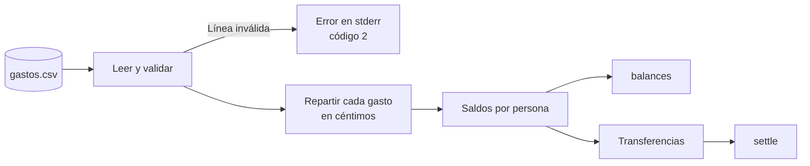

# 📋 Encargo · Dividir la cuenta

## La pregunta del dominio
> **Después de repartir, ¿la suma de lo que se debe es exactamente cero, sin un céntimo perdido ni inventado?**

Todo lo demás está al servicio de esa pregunta: el tipo de número, cómo se reparten los céntimos que no se dividen, y las pruebas.

## Contexto
Un grupo de amigos comparte gastos: una cena, un viaje, un regalo. Cada gasto lo paga una persona y lo comparten varias. Al final quieren saber **cuánto debe o recibe cada quien** y **qué transferencias hacer** para quedar a mano. Lo usan desde la terminal, con un archivo CSV que cualquiera puede escribir o exportar desde una hoja de cálculo.

## Dominio
| Concepto | Reglas |
|---|---|
| **Gasto** | Quién pagó (`payer`), cuánto (`amount`) y entre quiénes se reparte (`participants`). Quien paga puede no participar (por ejemplo, un regalo) |
| **Monto** | Positivo, con punto decimal y como máximo 2 decimales: `12`, `12.5`, `12.50`. Nada de comas, signos ni notación científica |
| **Reparto** | En partes iguales, **en céntimos**. Los céntimos que no se dividen exacto van uno por uno a los participantes **en orden alfabético**: 100,00 entre `ana`, `beto` y `caro` → 33,34 · 33,33 · 33,33 |
| **Saldo** | Lo que una persona pagó menos lo que le toca. Positivo: le deben. Negativo: debe. **La suma de todos los saldos es 0,00 exacto** |
| **Transferencia** | Quien debe le paga a quien le deben. Juntas llevan todos los saldos a cero, con como mucho (personas − 1) transferencias |



## Contrato

**Entrada:** un archivo CSV en UTF-8 (también se acepta el UTF-8 con BOM que guarda Excel), con este encabezado exacto:

```text
payer,amount,participants
ana,90.00,ana;beto;caro
beto,30.00,beto;caro
```

Los participantes van separados por `;`. Los espacios alrededor de nombres y montos no cuentan, y las líneas en blanco se ignoran.

**Comandos:**

| Comando | Salida (stdout, UTF-8) | Código |
|---|---|---|
| `balances <archivo>` | Una línea por persona, ordenadas por nombre: `ana +60.00`, `beto -15.00`, `caro -45.00`. Un saldo cero va sin signo: `dani 0.00` | 0 |
| `settle <archivo>` | Una línea por transferencia: `beto -> ana: 15.00` | 0 |

**Errores:** un archivo inválido o inexistente no imprime nada en stdout, escribe un mensaje en **stderr** que nombra la línea (`line 3: …`) y termina con **código 2**. Un comando desconocido también termina con código 2.

## Criterios de aceptación
Cada uno tiene su prueba de caja negra en [`acceptance/test_acceptance.py`](acceptance/test_acceptance.py).

| # | Dado | Cuando | Entonces |
|---|---|---|---|
| A1 | Una cena de 90 entre tres y 30 entre dos | `balances` | `ana +60.00`, `beto -15.00`, `caro -45.00` |
| A2 | 100,00 que paga `beto` entre `caro;beto;ana` | `balances` | El céntimo extra le toca a `ana`: `ana -33.34`, `beto +66.67`, `caro -33.33` |
| A3 | Montos que no se dividen exacto (tercios, céntimos sueltos, 29 filas) | `balances` | La suma de los saldos es exactamente 0 |
| A4 | Varios gastos cruzados | `settle` | Aplicar las transferencias deja todos los saldos en 0, con como mucho (personas − 1) transferencias |
| A5 | Una línea con coma decimal, tres decimales, un monto negativo o sin participantes | cualquier comando | Código 2, stdout vacío, stderr nombra la línea |
| A6 | Un archivo que no existe | `balances` | Código 2, stdout vacío, un mensaje en stderr |
| A7 | Un comando desconocido | `average` | Código 2, stdout vacío |
| A8 | Nombres con tilde (`maría`, `josé`) | `balances` | Salen intactos en la salida |
| A9 | Un archivo guardado con BOM | `balances` | Se procesa normal |

## Requisitos de las pruebas (lo que aplica del bloque)
| Requisito | Aprendido en |
|---|---|
| Pruebas unitarias de las reglas de dinero y del reparto, con casos en los límites | [1.2](../02-first-tests/README.md) |
| Casos de validación parametrizados, con IDs legibles | [1.3](../03-parametrize/README.md) |
| La CLI probada con archivos temporales (`tmp_path`) y su salida capturada con `capsys` | [1.4](../04-fixtures-doubles/README.md) |
| Cobertura de ramas revisada; ninguna rama de las reglas queda sin probar | [1.5](../05-coverage-flaky/README.md) |
| Ver fallar cada prueba importante al menos una vez | [1.1](../01-why-test/CONCEPT.md) |

## Fijo y libre
- **Fijo:** el contrato de arriba (formato de entrada, salida, códigos de salida) y Python 3.12+ si usas Python. Las pruebas de aceptación solo miran eso.
- **Libre:** la estructura interna, los nombres de módulos y clases, cómo calculas las transferencias (mientras cumplan A4) e incluso el lenguaje.

## Fuera de alcance
- Monedas distintas, porcentajes o repartos desiguales.
- Guardar el estado entre ejecuciones: cada ejecución lee el archivo completo.
- El número **mínimo** de transferencias. Encontrarlo exige, en general, probar combinaciones de personas que salden entre sí, lo que crece muy rápido con el tamaño del grupo. Basta con no pasar de (personas − 1).
