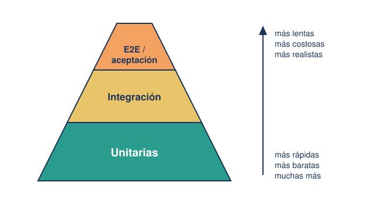
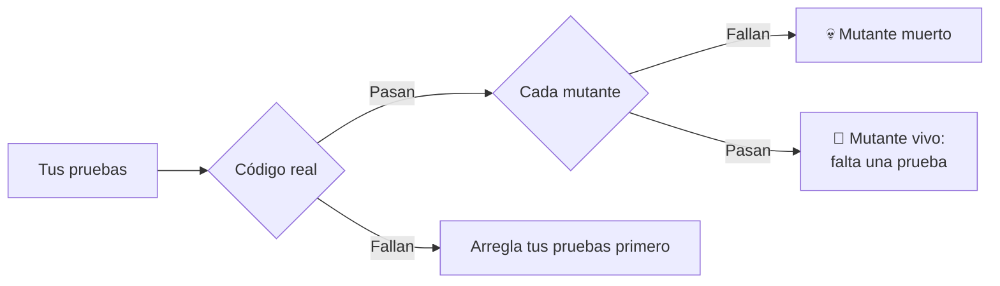

# 🧠 Qué es una prueba y sus tipos · Conceptos

## El problema
Escribiste una función que calcula el total de una compra con descuento. La probaste a mano: la llamaste en la consola con un par de valores, miraste el resultado y te pareció bien. Una semana después alguien cambia el cálculo del descuento. ¿Sigue funcionando el total? Para saberlo tendrías que volver a probar todo a mano: cada caso, cada vez, sin olvidar ninguno. Con diez funciones ya no es posible; con cien, nadie lo hace.

## Una prueba automatizada
La idea es escribir esa comprobación **una vez, como código**, y que la computadora la repita cada vez que quieras, en segundos. Una **prueba automatizada** (*automated test*) es código que ejecuta tu código con datos conocidos y compara el resultado con el esperado. Si coinciden, pasa; si no, falla y te avisa, sin que tengas que mirar nada.

```python
def test_a_purchase_of_100_gets_10_percent_off():
    assert total(100) == 90
```

Piénsala como una alarma de humo: no apaga el incendio, pero avisa a tiempo. Y una alarma sin pila es peor que no tener alarma, porque da una tranquilidad falsa. La analogía tiene un límite importante: una alarma detecta cualquier humo, y una prueba **solo detecta lo que le pediste revisar**. Este curso trata sobre pruebas que de verdad pueden sonar.

Al conjunto de pruebas de un proyecto se le llama **suite de pruebas** (*test suite*), o simplemente la suite.

## Para qué sirven
- **Respuesta rápida.** Sabes en segundos si un cambio rompió algo, no días después por el reporte de un usuario.
- **Cambiar sin miedo.** Con una buena red de pruebas puedes reorganizar el código (refactorizar) y comprobar que todo sigue funcionando.
- **Documentación que no miente.** Una prueba muestra cómo se usa el código y qué se espera de él, y si queda desactualizada, falla.
- **Mejor diseño.** El código difícil de probar suele estar demasiado acoplado: hace muchas cosas y depende de todo. Escribir la prueba lo revela temprano.

## Tres niveles: unitaria, integración y aceptación
No todas las pruebas miran el mismo tamaño de sistema. Toma una tienda en línea que calcula el total de un carrito, lee los precios de una base de datos y se usa desde una página web. Se puede probar a tres alturas:

| Nivel | Qué prueba | En la tienda | Velocidad | Cuando falla, te dice… |
|---|---|---|---|---|
| **Unitaria** (*unit test*) | Una función o una clase, aislada de todo lo demás | `total()` con precios escritos en la prueba | Milisegundos | Exactamente qué pieza se rompió |
| **Integración** (*integration test*) | Varias piezas juntas, o una pieza con algo real: un archivo, una base de datos | `total()` leyendo los precios de una base de datos de prueba | Segundos | Que las piezas no encajan |
| **Aceptación** o **extremo a extremo** (*acceptance*, *end-to-end*) | El sistema completo, como lo usa una persona: la página, la línea de comandos, la API | Abrir la tienda, agregar productos y ver el total en pantalla | Segundos a minutos | Que algo, en algún lugar, no cumple lo prometido |

## La pirámide de pruebas
Los tres niveles no cuestan lo mismo. Mira cómo cambian la velocidad y el costo según la altura:



La **pirámide de pruebas** (*test pyramid*) resume una recomendación: muchas pruebas rápidas abajo y pocas lentas arriba. Las unitarias atrapan la mayoría de los errores de lógica y dicen exactamente dónde están; las de aceptación confirman que todo junto funciona, pero son lentas y, cuando fallan, hay que investigar dónde. Es una guía, no una ley. Este camino de estudio sube la pirámide de abajo hacia arriba: el bloque 1 son las unitarias, el bloque 2 las de integración y el bloque 3 las de aceptación.

## Anatomía de una prueba: Arrange, Act, Assert
Casi toda prueba, en cualquier nivel, tiene tres partes: preparar, actuar y comprobar. En inglés se llaman **Arrange, Act, Assert** (AAA), y así las vas a encontrar en el trabajo.

```python
def test_discount_applies_from_100():
    cart = Cart()                      # Arrange: prepara el escenario
    cart.add("teclado", 100)

    total = cart.total()               # Act: ejecuta lo que quieres probar

    assert total == 90                 # Assert: comprueba el resultado
```

En pytest, la herramienta de este curso, una prueba es una función cuyo nombre empieza con `test_`, dentro de un archivo `test_*.py`, y comprueba con un `assert` normal de Python. Lo verás funcionando en el lab 1.2. Si quieres decirlo en lenguaje de negocio, es lo mismo que *Dado* (Given) / *Cuando* (When) / *Entonces* (Then).

## Qué hace buena a una prueba
| Propiedad | Significa | Si falta… |
|---|---|---|
| **Rápida** | Corre en milisegundos | No la corres seguido, y deja de avisar a tiempo |
| **Aislada** | No depende de otras pruebas ni de su orden | Falla o pasa según qué corrió antes |
| **Repetible** | Da el mismo resultado hoy, mañana y en otra máquina | No sabes si falló tu código o el reloj, la red o el azar |
| **Autoverificable** | Dice sola si pasó o falló, sin que leas nada | Alguien tiene que interpretar la salida, y nadie lo hará |
| **Enfocada y legible** | Prueba una idea, y su nombre la dice | Cuando falla, no sabes qué se rompió |

Se suele resumir con la sigla en inglés *FIRST* (Fast, Isolated, Repeatable, Self-validating, Timely). La última significa que la escribes cuando escribes el código, no meses después.

## La prueba que pasa por la razón equivocada
Este es el concepto central del curso. Una prueba en verde solo vale si **podía ponerse roja**. Mira este archivo: la función `total` tiene un bug (multiplica por 2), y aun así pytest dice que todo está bien.

```python
def total(prices):
    return sum(prices) * 2  # bug: debería ser sum(prices)


def check_total():  # sin el prefijo test_: pytest nunca la ejecuta
    assert total([1, 2]) == 3


def test_every_item_positive():
    items = []  # imagina una consulta que no devolvió nada
    for item in items:
        assert item > 0  # nunca se ejecuta


def test_runs_but_checks_nothing():
    total([1, 2])  # ejecuta el código, pero no comprueba nada
```

```text
test_wrong_reason.py::test_every_item_positive PASSED                    [ 50%]
test_wrong_reason.py::test_runs_but_checks_nothing PASSED                [100%]

============================== 2 passed in 0.01s ==============================
```

Tres trampas en un solo archivo:
1. **La prueba que nunca corre.** `check_total` no empieza con `test_`, así que pytest no la recolecta. Fíjate en la salida: solo hay 2 pruebas. Y si la corrida no recolecta ninguna prueba, pytest dice `no tests ran` y termina con el código de salida 5.
2. **La prueba que pasa porque no hay nada que revisar.** El `for` sobre una lista vacía no ejecuta ningún `assert`.
3. **La prueba sin comprobación.** Ejecuta el código pero no verifica nada; solo fallaría si el código lanzara una excepción.

La defensa es una regla simple: **ve fallar cada prueba al menos una vez.** Escríbela, rompe a propósito el código que prueba (o escribe la prueba antes que el código) y confirma que se pone roja. Si nunca la viste en rojo, no sabes si puede ponerse roja.

## Mutantes: romper a propósito
Ese «romper a propósito» tiene nombre. Un **mutante** (*mutant*) es una copia del código con un bug pequeño sembrado: un `>=` cambiado por `>`, un `+` por un `-`. Una buena suite **mata** a los mutantes: falla contra ellos. Un mutante que sobrevive es un bug que tus pruebas dejarían pasar.



Desde el lab 1.2, tus pruebas se validan así, con una **caza de mutantes**: deben pasar con el código real y fallar contra cada mutante.

## Qué probar (y qué no)
- **Prueba el comportamiento, no los detalles internos.** «Con 100 de compra hay descuento» es comportamiento; «la función llama a `_apply_rule` dos veces» es un detalle que puede cambiar sin que nada se rompa.
- **Prueba los límites y los errores.** Los bugs viven en los bordes (cero, vacío, el valor exacto de un umbral) y en las entradas inválidas. Cómo elegir esos casos es el tema del lab 1.3.
- **No pruebes lo que no es tuyo.** No hace falta comprobar que `sorted` de Python ordena; sí que tu código lo usa bien.
- **Mide tu suite con criterio.** La cobertura, la métrica más común sobre pruebas, la verás en el lab 1.6.

## Fuentes
- [Martin Fowler · TestPyramid](https://martinfowler.com/bliki/TestPyramid.html): el origen y los matices de la pirámide.
- [Ham Vocke · The Practical Test Pyramid](https://martinfowler.com/articles/practical-test-pyramid.html): la pirámide aplicada, con ejemplos.
- [Bill Wake · 3A – Arrange, Act, Assert](https://xp123.com/3a-arrange-act-assert/): el origen del nombre.
- [pytest · Good Integration Practices](https://docs.pytest.org/en/stable/explanation/goodpractices.html): cómo descubre pytest las pruebas y cómo organizarlas.
- [pytest · Changing standard test discovery](https://docs.pytest.org/en/stable/example/pythoncollection.html): reglas de nombres (`test_*.py`, `test_*`).
- [pytest · Exit codes](https://docs.pytest.org/en/stable/reference/exit-codes.html): el código 5 cuando no se recolectó ninguna prueba.
