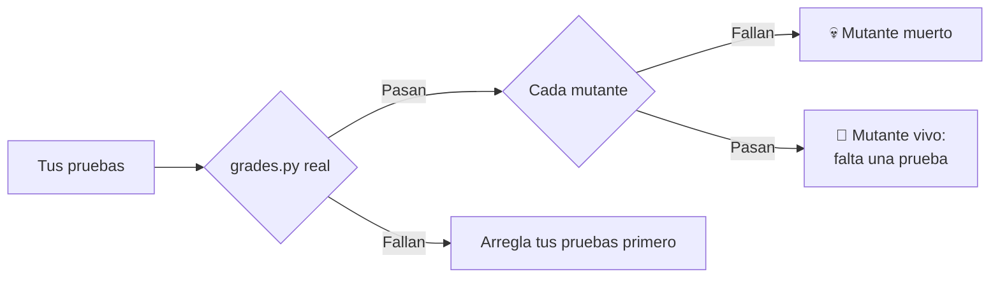

# 🧩 1.2 · Primeras pruebas con pytest

| ⏱️ Duración | 🧪 Tipo | 🏷️ Tipo de tema | 🛠️ Stack |
|---|---|---|---|
| 1–2 h | 🧩 `challenge` | 🎯 `core` | Python 3.12+ · pytest 9.2 |

## 🎯 Objetivos
- Escribir pruebas que pytest encuentra y ejecuta, usando un `assert` normal de Python.
- Comparar números decimales con `pytest.approx` y explicar por qué hace falta.
- Probar que el código lanza un error con `pytest.raises`, incluido su mensaje.
- Leer un fallo de pytest y elegir qué pruebas correr (`-k`, `-x`, `-v`).
- Ver tus pruebas fallar por la razón correcta: matar mutantes.

## 💡 Por qué importa
En el [lab 1.1](../01-what-is-a-test/CONCEPT.md) viste qué es una prueba y por qué una prueba que no puede fallar no vale nada. Aquí escribes las primeras, con la herramienta que se usa en casi todos los proyectos Python. Todo lo demás del camino (diseñar casos, fixtures, dobles, cobertura) se construye sobre esto: una prueba que comprueba lo correcto, en el caso correcto, y que avisa con un mensaje que se entiende.

## 📍 Dónde correr los comandos
Activa el entorno virtual (ver [SETUP.md](../../../SETUP.md)) y abre una terminal **dentro de la carpeta `starter/` de este lab**. Comprueba dónde estás:

PowerShell:

```powershell
Get-Location
```

Bash:

```bash
pwd
```

> [!NOTE]
> Usa siempre `python -m pytest` y no solo `pytest`: así corre el pytest de tu entorno virtual, con la carpeta actual en la ruta de importación.

## 🧠 Conceptos
Todos los ejemplos de esta sección usan una función distinta a la del lab, para que las tareas sigan siendo tuyas: `to_celsius(fahrenheit)`, que convierte temperaturas.

**Cómo encuentra pytest tus pruebas (*test discovery*).** No le dices a pytest qué funciones correr: las busca solo. Recorre los archivos cuyo nombre empieza con `test_` y, dentro, ejecuta las funciones que empiezan con `test_`. Por eso, en el lab 1.1, `check_total` nunca corrió. A ese proceso se le llama **descubrimiento** o **recolección** (*collection*).

**Comprobar con `assert`.** Una prueba es una función común que termina con un `assert`: si la condición es falsa, la prueba falla. Lo especial de pytest es que, cuando falla, **muestra los valores de cada lado** sin que escribas un mensaje. A eso se le llama introspección del `assert`. Si `to_celsius` tuviera un bug (restar 30 en vez de 32), esta prueba:

```python
def test_water_boils_at_100():
    assert to_celsius(212) == 100
```

fallaría así:

```text
E       assert 101.11111111111111 == 100
E        +  where 101.11111111111111 = to_celsius(212)
```

La primera línea dice qué se comparó; la segunda, de dónde salió el valor. Leer un fallo es leer estas dos líneas.

**Decimales: `pytest.approx`.** En Python, `0.1 + 0.2 == 0.3` es `False`. No es un bug de Python: la computadora guarda los decimales en binario, y 0,1 no tiene una representación exacta, como 1/3 no la tiene en decimal (0,333…). El resultado es `0.30000000000000004`. Comparar decimales con `==` da fallos falsos; la solución es comparar **con una tolerancia**, y eso hace `pytest.approx`:

```python
def test_body_temperature():
    assert to_celsius(98.6) == pytest.approx(37.0)
```

**Errores esperados: `pytest.raises`.** A veces lo correcto es que el código **falle**: una temperatura bajo el cero absoluto debería lanzar un `ValueError`. Si el error no ocurre, la prueba debe fallar. `pytest.raises` es un bloque `with` que hace exactamente eso, y su argumento `match` revisa además el mensaje:

```python
def test_below_absolute_zero_is_an_error():
    with pytest.raises(ValueError, match="below absolute zero"):
        to_celsius(-500)
```

Un detalle de `match`: no busca el texto tal cual, sino una **expresión regular** (*regular expression*), un pequeño lenguaje para describir patrones de texto, donde algunos caracteres como `[`, `]`, `.` o `$` tienen un significado especial.

**La caza de mutantes en la práctica.** En el lab 1.1 viste qué es un mutante. Aquí cada mutante es una copia de `grades.py` con un bug sembrado, guardada en su propia carpeta. Un archivo de pruebas que ya viene escrito, la **caza**, corre tus pruebas varias veces: primero con el código real, y después con cada mutante en su lugar.



## 📚 Documentación
- [pytest · Get Started](https://docs.pytest.org/en/stable/getting-started.html)
- [pytest · How to write and report assertions in tests](https://docs.pytest.org/en/stable/how-to/assert.html)
- [pytest · `pytest.approx`](https://docs.pytest.org/en/stable/reference/reference.html#pytest-approx) y [`pytest.raises`](https://docs.pytest.org/en/stable/reference/reference.html#pytest-raises)
- [pytest · How to invoke pytest](https://docs.pytest.org/en/stable/how-to/usage.html) (`-k`, `-x`, `-v`)
- [Python · Floating-point arithmetic: issues and limitations](https://docs.python.org/3/tutorial/floatingpoint.html)

## 🧭 Escenario
[`grades.py`](starter/grades.py) ya funciona: calcula notas de un curso en escala de 0 a 100. **No lo cambies.** Tu trabajo está en [`tests/test_grades.py`](starter/tests/test_grades.py), que trae seis pruebas que todavía solo dicen `pytest.skip("TODO …")`: pytest las salta sin ejecutarlas.

| Función | Promete |
|---|---|
| `average(grades)` | El promedio. Lista vacía → `ValueError`. Una nota fuera de 0–100 → `ValueError("grade out of range [0, 100]: …")` |
| `passed(grade)` | `True` si la nota llega a 60. **El 60 aprueba.** |
| `ranking(students)` | Nombres de la mejor nota a la peor; **los empates, en orden alfabético** |

Los casos de este lab vienen dados por la tabla. En el [lab 1.3](../03-test-case-design/README.md) aprenderás a elegirlos tú.

La caza está en [`tests/test_mutant_hunt.py`](starter/tests/test_mutant_hunt.py) y los mutantes en [`tests/mutants/`](starter/tests/mutants/):

| Mutante | Bug sembrado | Lo mata la tarea |
|---|---|---|
| `m1-integer-division` | El promedio usa `//` (división entera) en vez de `/` | 1 |
| `m2-empty-returns-zero` | `average([])` devuelve `0.0` en vez de lanzar el error | 2 |
| `m3-no-range-check` | Acepta notas hasta 1000 | 2 |
| `m4-strict-boundary` | `passed` usa `>` en vez de `>=` | 3 |
| `m5-ties-insertion-order` | Los empates quedan en el orden en que llegaron | 4 |

> [!TIP]
> Intenta no abrir los mutantes: la tabla basta. Si te atascas, abrir uno es una pista legítima.

## ✅ Tareas

Corre todo así (tus pruebas y la caza):

PowerShell:

```powershell
python -m pytest
```

Bash:

```bash
python -m pytest
```

### Tarea 1 · El promedio
**Meta:** comprobar `average` con valores enteros y decimales. **La valida:** `test_your_tests_catch[m1-integer-division]`.

- [ ] En `test_average_of_several_grades`, comprueba el promedio de `[70, 85, 90]`.
- [ ] En `test_average_of_decimal_grades`, comprueba que el promedio de `[0.1, 0.2]` es `0.15`.

🔮 **Predict first:** ¿pasará `assert average([0.1, 0.2]) == 0.15`? Escríbelo así primero y córrelo solo con tus pruebas:

PowerShell:

```powershell
python -m pytest tests/test_grades.py
```

Bash:

```bash
python -m pytest tests/test_grades.py
```

### Tarea 2 · Los errores
**Meta:** comprobar que la entrada inválida lanza `ValueError`. **La validan:** `[m2-empty-returns-zero]` y `[m3-no-range-check]`.

- [ ] En `test_average_of_no_grades_is_an_error`, usa `with pytest.raises(ValueError):` alrededor de `average([])`.
- [ ] En `test_grade_out_of_range_is_an_error`, comprueba que `average([90, 120])` lanza `ValueError` **y que el mensaje contiene `out of range [0, 100]`**.

🔮 **Predict first:** ¿pasará `pytest.raises(ValueError, match="out of range [0, 100]")`?

### Tarea 3 · El límite
**Meta:** comprobar el borde exacto de `passed`. **La valida:** `[m4-strict-boundary]`.

- [ ] En `test_the_passing_grade_itself_passes`, comprueba que 60 aprueba y que una nota apenas menor no.

🔮 **Predict first:** si escribes las dos comprobaciones, `assert passed(60)` y `assert not passed(59.9)`, ¿cuál de ellas mata al mutante m4?

### Tarea 4 · Los empates
**Meta:** comprobar que los empates salen en orden alfabético. **La valida:** `[m5-ties-insertion-order]`.

- [ ] En `test_ties_are_in_alphabetical_order`, arma un diccionario con dos estudiantes empatados y uno con mejor nota, y comprueba el resultado de `ranking`.

🔮 **Predict first:** si escribes los empatados en orden alfabético (`{"ana": 90, "beto": 95, "zoe": 90}`), ¿muere el mutante m5?

Corre solo esta parte (tu prueba y su mutante):

PowerShell:

```powershell
python -m pytest -k ties -v
```

Bash:

```bash
python -m pytest -k ties -v
```

**Criterio de éxito:** `python -m pytest` dentro de `starter/` termina en verde: 12 pruebas pasan, ninguna se salta.

## 🔍 Command dissection
| Comando o código | Qué hace |
|---|---|
| `python -m pytest` | Corre las pruebas de `testpaths` (aquí, `tests/`) con el Python del entorno activo |
| `python -m pytest tests/test_grades.py` | Solo ese archivo: tus pruebas, sin la caza |
| `python -m pytest tests/test_grades.py::test_average_of_several_grades` | Una sola prueba |
| `-v` | Una línea por prueba con su resultado (`PASSED`, `FAILED`, `SKIPPED`) |
| `-q` | Salida mínima |
| `-k ties` | Solo las pruebas cuyo nombre o ID contiene `ties`; incluye `[m5-ties-insertion-order]` de la caza |
| `-x` | Se detiene en el primer fallo |
| `--tb=short` | Trazas de error más cortas |
| `pytest.approx(0.15)` | Un número que se compara «casi igual», con una tolerancia relativa muy pequeña |
| `with pytest.raises(ValueError) as error:` | Además guarda la excepción: `error.value` es el objeto, y `str(error.value)` su mensaje |
| `re.escape("…")` | Convierte un texto en una expresión regular que lo busca tal cual |

## 👀 Qué deberías ver
Al empezar, con el starter tal cual:

```text
FAILED tests/test_mutant_hunt.py::test_your_tests_catch[m1-integer-division]
FAILED tests/test_mutant_hunt.py::test_your_tests_catch[m2-empty-returns-zero]
FAILED tests/test_mutant_hunt.py::test_your_tests_catch[m3-no-range-check] - ...
FAILED tests/test_mutant_hunt.py::test_your_tests_catch[m4-strict-boundary]
FAILED tests/test_mutant_hunt.py::test_your_tests_catch[m5-ties-insertion-order]
=================== 5 failed, 1 passed, 6 skipped in 2.24s ====================
```

La prueba que ya pasa es `test_your_tests_pass_against_the_real_code`, el **guardián**: unas pruebas que se saltan no fallan contra el código real, pero tampoco matan a nadie. Cada tarea que resuelvas pone en verde sus mutantes.

## 💼 En proyectos reales
- **Nombra las pruebas por el comportamiento** (`test_the_passing_grade_itself_passes`), no por la función (`test_passed_2`): cuando falla en el CI, el nombre ya dice qué se rompió.
- **`approx` es para medidas, no para dinero.** Con montos se usa `Decimal` y se compara exacto; lo verás en el proyecto del bloque.
- **Escapa el texto en `match`** con `re.escape(...)` o busca un fragmento sin caracteres especiales.
- **Los mutantes no son solo de este curso:** existen herramientas de *mutation testing* que los generan solas a partir de tu código, como [mutmut](https://pypi.org/project/mutmut/). Son lentas para correrlas en cada cambio, pero muy útiles para auditar una suite (bloque 4).
- **El bug más caro es el que la prueba deja pasar.** Ante cada prueba pregúntate: ¿qué bug atrapa?

## 🚀 Reto extra
Escribe tu propio mutante: copia `grades.py` en `tests/mutants/m6-<nombre>/`, siembra un bug que tus pruebas actuales **no** atrapen (pista: el promedio de una sola nota, o una nota exactamente en 0 o en 100) y agrega la prueba que lo mata. La caza lo detecta solo.

## 🆘 Pistas
<details><summary>Pista 1 · dirección</summary>

Cada tarea es una prueba de tres líneas o menos. Si no sabes qué valor esperar, calcúlalo a mano antes de escribir el `assert`.
</details>

<details><summary>Pista 2 · más concreta</summary>

- Tarea 1: `assert average([0.1, 0.2]) == pytest.approx(0.15)`.
- Tarea 2: `with pytest.raises(ValueError, match=re.escape("out of range [0, 100]")):` (el `import re` ya está arriba).
- Tarea 4: escribe los empatados en orden **no** alfabético en el diccionario.
</details>

## ✔️ Respuestas verificadas
<details><summary>Ábrelas solo después de terminar las tareas</summary>

Todo esto se ejecutó con Python 3.12 y pytest 9.2.0.

**Tarea 1.** No pasa: el promedio real es `0.15000000000000002`.

```text
E   assert 0.15000000000000002 == 0.15
E    +  where 0.15000000000000002 = average([0.1, 0.2])
```

`pytest.approx(0.15)` acepta una diferencia relativa muy pequeña y la prueba pasa.

**Tarea 2.** No pasa: dentro de una expresión regular, `[0, 100]` es una clase de caracteres («un 0, una coma, un espacio o un 1»), no el texto literal.

```text
E   AssertionError: Regex pattern did not match.
E     Expected regex: 'out of range [0, 100]'
E     Actual message: 'grade out of range [0, 100]: 120'
```

**Tarea 3.** Solo `assert passed(60)` mata a m4. Con el mutante, `passed(60)` es `False` (falla, mutante muerto), pero `not passed(59.9)` sigue siendo `True`, porque 59.9 no aprueba con `>` ni con `>=`. La segunda línea igual vale: protege el otro lado del límite.

**Tarea 4.** No muere. Con `{"ana": 90, "beto": 95, "zoe": 90}` el orden de llegada ya es alfabético, así que el código real y el mutante devuelven lo mismo:

```text
E       AssertionError: Mutant 'm5-ties-insertion-order' survived: your tests still pass when grades.py has this bug.
```

Escribe los empatados al revés (`{"zoe": 90, "beto": 95, "ana": 90}`) y el mutante muere.
</details>

## 🎤 Autoevaluación
1. ¿Por qué `0.1 + 0.2 == 0.3` es `False` en Python, y cuándo usarías `approx` en vez de `Decimal`?
2. Una compañera escribe `pytest.raises(ValueError, match="cost: $10")` y la prueba falla aunque el mensaje es exactamente ese. ¿Qué pasa y cómo lo arreglas?
3. ¿Qué es un mutante, y qué te dice que uno sobreviva a tu suite?
4. Tienes un umbral `>= 18`. ¿Qué valores probarías y por qué esos?
5. Una prueba pasa con el código real y también con el bug. ¿Cómo diseñas los datos para que distinga los dos?

La solución completa está en [`solution/`](solution/).

## 🔁 Retrospectiva
- ¿Qué entendí?
- ¿Qué me costó?
- ¿Qué debería reforzar?

**Siguiente:** [1.3 · Diseño de casos de prueba](../03-test-case-design/README.md)
