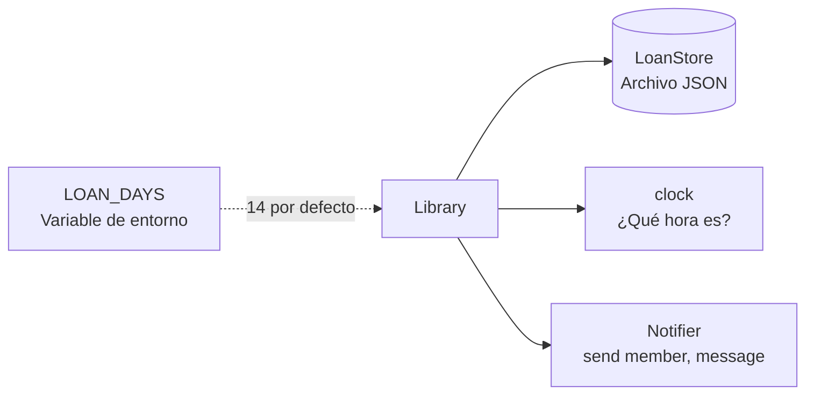

# 🧩 1.5 · Dobles de prueba

| ⏱️ Duración | 🧪 Tipo | 🏷️ Tipo de tema | 🛠️ Stack |
|---|---|---|---|
| 1,5–2 h | 🧩 `challenge` | 🎯 `core` | Python 3.12+ · pytest 9.2 |

## 🎯 Objetivos
- Explicar por qué un código que **recibe** sus dependencias se puede probar y uno que las crea adentro cuesta mucho.
- Distinguir los cinco tipos de dobles de prueba (dummy, stub, fake, spy y mock) y elegir el adecuado.
- Probar código que escribe archivos con `tmp_path`, sin dejar basura ni estado entre pruebas.
- Controlar el tiempo con un reloj falso, en vez de esperar o depender de la hora real.
- Comprobar cómo se llamó a una dependencia con un mock hecho con `create_autospec`.
- Cambiar una variable de entorno solo durante una prueba con `monkeypatch`.

## 💡 Por qué importa
Hasta ahora probaste funciones que solo calculan: entran datos y salen datos. El código real hace más: guarda archivos, mira la hora, lee la configuración del entorno y habla con otros sistemas (manda correos, llama a una API). Probarlo tal cual da pruebas lentas, que fallan según el día en que corren y que mandan correos de verdad. Las pruebas unitarias necesitan **aislar** el código de todo eso.

## 📍 Dónde correr los comandos
Con el entorno virtual activo, en la carpeta **`starter/`** de este lab.

## 🧠 Conceptos
En el [lab 1.4](../04-organize-suite/README.md) usaste fixtures para preparar lo que una prueba necesita. Aquí vas a preparar algo distinto: **reemplazos** de las cosas que tu código no controla.

### Recibir en vez de crear (*dependency injection*)
Compara estas dos versiones de una función que decide si una tienda está abierta:

```python
from datetime import datetime

def is_open():                        # crea su dependencia adentro
    return 9 <= datetime.now().hour < 18

def is_open_at(clock):                # la recibe
    return 9 <= clock().hour < 18
```

¿Cómo pruebas la primera a las 20:00 si corres la suite a las 10:00? No hay forma limpia: la hora real está escondida adentro. La segunda **recibe** el reloj, así que la prueba le pasa uno que diga la hora que haga falta. Diseñar el código para que reciba lo que cambia (la hora, los archivos, los servicios) se llama **inyección de dependencias**, y es lo que hace posible el resto de este lab.

### Dobles de prueba (*test doubles*)
Un doble es un objeto que ocupa el lugar de una dependencia real durante una prueba, como el doble de riesgo que reemplaza al actor en una escena peligrosa. La analogía tiene un límite: el doble de cine imita al actor entero, y un doble de prueba solo necesita imitar lo poco que la prueba usa. Hay cinco tipos:

| Tipo | Qué hace | Ejemplo con un servicio de correo |
|---|---|---|
| **Dummy** | Solo ocupa un lugar; nunca se usa | Un objeto cualquiera que se pasa porque el constructor lo exige |
| **Stub** | Devuelve respuestas fijas | Un `send` que siempre devuelve `True` |
| **Fake** | Funciona de verdad, pero de forma simple | Un buzón en memoria: guarda los correos en una lista |
| **Spy** | Funciona como un stub y además **anota** cómo lo llamaron | Un `send` que guarda cada destinatario para revisarlo después |
| **Mock** | Anota las llamadas y la prueba **comprueba** que fueron las esperadas | «Se llamó a `send` una vez, con `ana` y este mensaje» |

Los dos que más vas a usar son el **fake**, cuando la prueba necesita que la dependencia funcione (un reloj que avanza), y el **mock**, cuando lo que importa es **qué le pidió** tu código a la dependencia.

### Mocks con la forma de la clase real (`create_autospec`)
Python trae mocks en `unittest.mock`. `create_autospec(Clase, instance=True)` crea uno con la **forma** de la clase real: acepta sus métodos, con sus argumentos, y anota cada llamada para que la prueba la revise.

```python
from unittest.mock import create_autospec

mailer = create_autospec(Mailer, instance=True)
notify_late_members(mailer)                                            # el código bajo prueba lo usa
mailer.send.assert_called_once_with("ana", "Please return 'Dune'")     # la prueba revisa la llamada
```

### Lugares reales, pero desechables (`tmp_path` y `monkeypatch`)
No todo hay que reemplazarlo por un doble. Para los archivos, pytest trae la fixture `tmp_path`: una carpeta temporal nueva para cada prueba (un `pathlib.Path`). El código escribe de verdad, pero en un lugar que nadie más usa. Para las variables de entorno, la fixture `monkeypatch` cambia una variable durante la prueba y **la restaura** al terminar:

```python
def test_reads_the_region(monkeypatch):
    monkeypatch.setenv("REGION", "lima")    # solo durante esta prueba
    assert current_region() == "lima"
```

## 📚 Documentación
- [Martin Fowler · Mocks Aren't Stubs](https://martinfowler.com/articles/mocksArentStubs.html) y [Test Double](https://martinfowler.com/bliki/TestDouble.html)
- [pytest · How to use temporary directories and files](https://docs.pytest.org/en/stable/how-to/tmp_path.html)
- [pytest · How to monkeypatch/mock modules and environments](https://docs.pytest.org/en/stable/how-to/monkeypatch.html)
- [Python · `unittest.mock`: autospeccing](https://docs.python.org/3/library/unittest.mock.html#autospeccing)

## 🧭 Escenario

### El código
[`loans.py`](starter/loans.py) ya funciona: los préstamos de una biblioteca. **No lo cambies.** `Library` recibe sus tres dependencias, y cada una se reemplaza de una forma distinta:



| Dependencia | En producción | En tus pruebas |
|---|---|---|
| `LoanStore` | Un archivo JSON en disco | El mismo `LoanStore`, sobre un archivo en `tmp_path` |
| `clock` | `datetime.now` | Un **fake**: `FakeClock`, que solo avanza cuando la prueba lo dice |
| `Notifier` | Un servicio de correo | Un **mock** hecho con `create_autospec(Notifier, instance=True)` |
| `LOAN_DAYS` | Una variable de entorno | `monkeypatch.setenv` |

| Método | Promete |
|---|---|
| `lend(book, member)` | Guarda el préstamo en el archivo. Un libro ya prestado → `ValueError("already lent: …")` |
| `overdue()` | Los préstamos con **más** días que el plazo. El último día todavía no es atraso |
| `send_reminders()` | Un aviso por préstamo atrasado, con `notifier.send(member, "Please return '<book>'")`; devuelve cuántos envió |
| `loan_days()` | El plazo: `LOAN_DAYS` del entorno, o 14 |

En [`tests/conftest.py`](starter/tests/conftest.py) ya están la parte de la caza y la clase `FakeClock`. Tus pruebas van en [`tests/test_loans.py`](starter/tests/test_loans.py).

### Cómo se revisa tu trabajo
La caza de mutantes del lab 1.2:

| Mutante | Bug sembrado | Lo mata la tarea |
|---|---|---|
| `m1-save-is-noop` | `save()` no escribe nada | 1 |
| `m2-double-lending-allowed` | Se puede prestar un libro ya prestado | 1 |
| `m3-last-day-is-late` | El último día ya cuenta como atraso (`>=`) | 2 |
| `m4-ignores-the-clock` | `overdue()` usa la hora real (`datetime.now()`) y no el reloj recibido | 2 |
| `m5-reminds-everyone` | Avisa a todos, atrasados o no | 3 |
| `m6-calls-a-missing-method` | Llama a `notifier.send_message(...)`, que no existe | 3 |
| `m7-ignores-the-environment` | El plazo siempre es 14, diga lo que diga `LOAN_DAYS` | 4 |

## ✅ Tareas

Corre todo con este comando, igual en PowerShell o Bash:

```bash
python -m pytest
```

### Tarea 1 · Los dobles como fixtures, y un archivo temporal
**Meta:** preparar la biblioteca con sus dobles una sola vez, y probar lo que guarda. **La validan:** `[m1-save-is-noop]` y `[m2-double-lending-allowed]`.

- [ ] En `conftest.py`, escribe cuatro fixtures, como en el lab 1.4:
  - `clock`: devuelve un `FakeClock(datetime(2026, 1, 15, 9, 0))`;
  - `notifier`: `create_autospec(Notifier, instance=True)`;
  - `store`: un `LoanStore` sobre `tmp_path / "loans.json"` (pide `tmp_path` como parámetro);
  - `library`: pide las otras tres y arma la `Library`.
- [ ] En `test_a_loan_is_saved_to_the_file(library, tmp_path)`: presta un libro y léelo con un `LoanStore` **nuevo** sobre el mismo archivo. Dentro de una misma prueba, `tmp_path` es la misma carpeta que recibió `store`.
- [ ] En `test_a_book_cannot_be_lent_twice(library)`: el segundo préstamo del mismo libro lanza `ValueError`.

🔮 **Predict first:** ¿y si `store` usara una ruta fija, `LoanStore(Path("loans.json"))`, en vez de `tmp_path`? Es el mismo archivo en todas las pruebas. ¿Qué pruebas fallan, y qué pasa la segunda vez que corres la suite?

### Tarea 2 · Un reloj que controla la prueba (un fake)
**Meta:** probar el límite del plazo sin esperar 14 días. **La validan:** `[m3-last-day-is-late]` y `[m4-ignores-the-clock]`.

- [ ] En `test_a_loan_is_not_overdue_on_its_last_day`: presta un libro, avanza el reloj **exactamente** 14 días (`clock.advance(days=14)`) y comprueba que **no** está atrasado.
- [ ] En `test_a_loan_is_overdue_after_its_last_day`: avanza 14 días y 1 segundo y comprueba que sí lo está.

🔮 **Predict first:** ¿cuál de las dos pruebas mata al mutante que usa la hora real?

### Tarea 3 · Un mock del notificador
**Meta:** comprobar a quién se avisó, sin enviar nada de verdad. **La validan:** `[m5-reminds-everyone]` y `[m6-calls-a-missing-method]`.

- [ ] Presta `"Dune"` a `"ana"`, avanza 10 días, presta `"Emma"` a `"beto"` y avanza 5 más: el primero está atrasado y el segundo no.
- [ ] Comprueba que `send_reminders()` devuelve 1 **y** que el notificador recibió exactamente ese aviso, con `assert_called_once_with`.

🔮 **Predict first:** si solo compruebas que `send_reminders()` devuelve 1, ¿qué mutantes sobreviven?

### Tarea 4 · Variables de entorno con `monkeypatch`
**Meta:** probar que el plazo se lee del entorno, sin afectar a otras pruebas. **La valida:** `[m7-ignores-the-environment]`.

- [ ] Pide la fixture `monkeypatch` y usa `monkeypatch.setenv("LOAN_DAYS", "7")`.
- [ ] Presta un libro, avanza 8 días y comprueba que está atrasado.

🔮 **Predict first:** ¿qué pasaría si en lugar de `monkeypatch` escribieras `os.environ["LOAN_DAYS"] = "7"`?

**Criterio de éxito:** `python -m pytest` dentro de `starter/` termina en verde: 14 pruebas pasan, ninguna se salta.

## 🔍 Command dissection
| Código | Qué hace |
|---|---|
| `mock.send.call_args_list` | Todas las llamadas que recibió `send`, para revisarlas a mano |
| `monkeypatch.delenv("X", raising=False)` | Quita `X` durante la prueba, sin error si no existía |
| `monkeypatch.setattr(objeto, "nombre", valor)` | Reemplaza un atributo o una función durante la prueba |

## 💼 En proyectos reales
- **Inyecta lo que cambia** (hora, archivos, red, servicios). Si el código crea sus dependencias adentro (`datetime.now()`, `smtplib.SMTP(...)`), tendrás que reemplazar partes de módulos con `monkeypatch.setattr`, y esas pruebas se rompen cuando alguien reorganiza los `import`.
- **Prefiere fakes para el comportamiento y mocks para las interacciones.** Abusar de los mocks ata las pruebas a cómo está escrito el código, no a lo que hace.
- **No hagas mock de lo que no es tuyo** si puedes evitarlo: en vez de imitar la librería de correo, envuélvela en una clase tuya pequeña (`Notifier`) y haz el doble de esa.
- **Aísla el entorno de la máquina:** si alguien tiene `LOAN_DAYS` definida en su terminal, las pruebas del plazo de 14 días fallarían solo en su equipo. Una fixture con `autouse=True` (que se aplica sola a todas las pruebas, sin pedirla) y `monkeypatch.delenv("LOAN_DAYS", raising=False)` lo evita.

## 🚀 Reto extra
Escribe un `FakeNotifier` (un fake: guarda los avisos en una lista) y reescribe la prueba de la tarea 3 con él en lugar del mock. ¿Qué mutantes mata? ¿Qué prueba te parece más legible? ¿Y cuál se rompería si `Library` empezara a mandar los avisos en otro orden?

## 🆘 Pistas
<details><summary>Pista 1 · dirección</summary>

Las cuatro fixtures se escriben igual que en el lab 1.4. `store` pide `tmp_path`, y `library` pide `store`, `clock` y `notifier`.
</details>

<details><summary>Pista 2 · más concreta</summary>

```python
@pytest.fixture
def store(tmp_path):
    return LoanStore(tmp_path / "loans.json")
```

Tarea 3: `notifier.send.assert_called_once_with("ana", "Please return 'Dune'")`.
</details>

## ✔️ Respuestas verificadas
<details><summary>Ábrelas solo después de terminar las tareas</summary>

Se ejecutó con pytest 9.2.0; el CI verifica cada lab en Python 3.12 y 3.15.

**Tarea 1.** Con la ruta fija fallan las seis pruebas, desde la primera corrida. `test_a_loan_is_saved_to_the_file` falla porque relee el archivo de `tmp_path`, que el `store` ya no usa. Las demás fallan porque todas comparten el mismo archivo, y una prueba anterior ya prestó el libro:

```text
E           ValueError: already lent: Dune
```

Además queda un `loans.json` en tu carpeta, así que la siguiente corrida arranca con los préstamos de la anterior. Con `tmp_path`, cada prueba tiene su propia carpeta y no queda nada.

**Tarea 2.** La prueba del último día. Sola, mata a `m3` y a `m4`; la de «un segundo después», sola, no mata a ninguno. El reloj falso está en enero de 2026; el mutante usa la hora real, que es posterior, y ve un atraso donde no lo hay. Un segundo después del plazo, el código real y el mutante dicen lo mismo («atrasado»). La prueba de la tarea 3 también atrapa a `m4`, porque depende del reloj: una suite completa suele matar a un mutante por más de un lado.

**Tarea 3.** Si solo compruebas el número devuelto, `m5-reminds-everyone` sobrevive: devuelve 1 aunque avise a dos personas. Para matarlo hay que preguntarle al doble con `assert_called_once_with`. Y `m6` muere por la forma del mock: `create_autospec` rechaza un método que `Notifier` no tiene.

```text
E   AttributeError: Mock object has no attribute 'send_message'
```

Con un `Mock()` común, sin `spec`, `m6` sobreviviría: acepta cualquier método, y un error de nombre pasaría las pruebas y explotaría en producción.

**Tarea 4.** `os.environ["LOAN_DAYS"] = "7"` deja la variable puesta para todo lo que corre después. En este archivo, la prueba del entorno es la última, así que tus pruebas pasan… pero la caza corre después y sus procesos heredan `LOAN_DAYS=7`. Contra el código real, la prueba del último día falla, el guardián se pone rojo y bloquea a los 7 mutantes:

```text
E   AssertionError: Your tests must pass against the real loans.py before they can catch mutants.
      1 failed, 5 passed in 0.09s
```

Y si la prueba del entorno corriera **antes** que las del reloj, rompería directamente la del último día. `monkeypatch.setenv` la restaura al terminar la prueba. Las pruebas que fallan según qué corrió antes son el tema del lab 4.1.
</details>

## 🎤 Autoevaluación
1. ¿Qué gana `Library` al recibir el reloj como parámetro en lugar de llamar a `datetime.now()`?
2. ¿En qué se diferencian un stub, un fake y un mock? Da un ejemplo de cuándo prefieres cada uno.
3. ¿Por qué un `Mock()` sin `spec` puede dejar pasar un bug de producción?
4. ¿Por qué `tmp_path` no es un doble, y por qué igual sirve para aislar una prueba?
5. Una prueba falla solo en la máquina de una compañera. ¿Qué variables de entorno o archivos revisarías, y cómo lo evitarías en la suite?

La solución completa está en [`solution/`](solution/).

**Siguiente:** [1.6 · Cobertura](../06-coverage/README.md)
