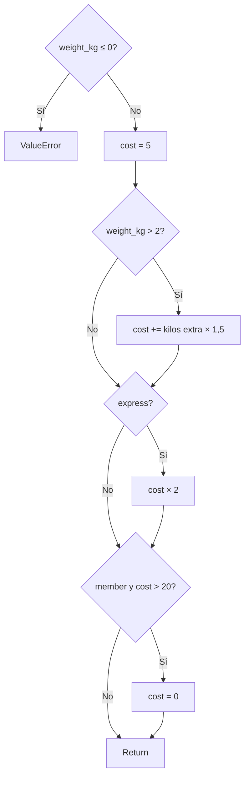

# 🔭 1.6 · Cobertura

| ⏱️ Duración | 🧪 Tipo | 🏷️ Tipo de tema | 🛠️ Stack |
|---|---|---|---|
| 45 min – 1 h | 🔭 `exploration` | 🎯 `core` | Python 3.12+ · pytest 9.2 · pytest-cov 7.1 |

## 🎯 Objetivos
- Medir la cobertura de líneas y de ramas con pytest-cov, y leer qué líneas y ramas faltan.
- Usar el reporte para encontrar un caso que nadie prueba.
- Explicar con un ejemplo por qué un 100% de cobertura, incluso de ramas, no garantiza que las pruebas atrapen bugs.

## 💡 Por qué importa
«Tenemos 100% de cobertura» es una de las frases más tranquilizadoras y más engañosas de un equipo. La cobertura es la métrica de pruebas que más vas a ver en el trabajo: aparece en el CI, en los pull requests y en las metas del equipo. Saber leerla te sirve para encontrar lo que nadie prueba; creerle de más te lleva a una suite que ejecuta todo y no comprueba nada.

## 📍 Dónde correr los comandos
Con el entorno virtual activo (ver [SETUP.md](../../../SETUP.md)), abre una terminal **dentro de la carpeta `demo/` de este lab**:

PowerShell:

```powershell
Get-Location
```

Bash:

```bash
pwd
```

## 🧠 Conceptos
En los labs 1.2 a 1.5, la caza de mutantes respondía una pregunta exigente: **¿tus pruebas atrapan bugs?** Para responderla había que preparar mutantes a mano. La cobertura responde una pregunta más simple y barata, que cualquier proyecto puede medir solo: **¿qué parte del código ejecutaron tus pruebas?**

**Cobertura de líneas.** Mientras corren las pruebas, una herramienta anota qué líneas del código se ejecutaron. Al final, el porcentaje de líneas ejecutadas es la **cobertura de líneas** (*line coverage*), y las que nunca se ejecutaron aparecen en una lista. Una línea que ninguna prueba ejecuta es una línea que ninguna prueba puede proteger.

**Cobertura de ramas.** Mira esta función:

```python
def price(amount, member):
    if member:
        amount = amount * 0.9
    return amount
```

Una sola prueba con `member=True` ejecuta **todas** las líneas: 100% de líneas. Pero el caso `member=False`, el más común, nunca se probó. Cada `if` abre dos caminos (se cumple o no se cumple), y la **cobertura de ramas** (*branch coverage*) mide si las pruebas recorrieron los dos. Aquí diría que falta un camino: el que salta el `if` y va directo al `return`.

**Lo que la cobertura no mide.** Que una línea se ejecute no significa que alguna prueba compruebe su resultado. Una prueba sin `assert` sube la cobertura igual que una buena. Por eso la cobertura sirve para encontrar **lo que falta**, no para demostrar que lo que hay está bien.

**La herramienta.** En Python, la cobertura la mide la librería **coverage.py**. El plugin **pytest-cov** la conecta con pytest: agrega opciones como `--cov` para medir mientras corren las pruebas. Ya está instalado con el `requirements.txt` del repositorio.

## 📚 Documentación
- [pytest-cov · Reporting](https://pytest-cov.readthedocs.io/en/latest/reporting.html)
- [coverage.py · Branch coverage measurement](https://coverage.readthedocs.io/en/latest/branch.html)
- [Martin Fowler · TestCoverage](https://martinfowler.com/bliki/TestCoverage.html)

## 🧭 Escenario
La `demo/` está terminada y funciona. No hay nada que completar: vas a medirla y a romperla a propósito.

| Archivo | Qué es |
|---|---|
| [`shipping.py`](demo/shipping.py) | Costo de envío: base de 5, más 1,5 por cada kilo sobre 2; el exprés cuesta el doble; los miembros no pagan si el costo pasa de 20 |
| [`tests/test_shipping.py`](demo/tests/test_shipping.py) | Tres pruebas que pasan |

Este diagrama muestra los caminos de `shipping_cost`. Fíjate en cuántas decisiones tiene: cada rombo es un `if` con dos salidas.



## 🧪 Experimentos

### Experimento 1 · La cobertura de líneas
🔮 **Predict first:** con solo tres pruebas, ¿qué porcentaje de las líneas de `shipping.py` crees que se ejecuta?

PowerShell:

```powershell
python -m pytest --cov=shipping --cov-report=term-missing
```

Bash:

```bash
python -m pytest --cov=shipping --cov-report=term-missing
```

<details><summary>👀 Qué deberías ver</summary>

```text
Name          Stmts   Miss  Cover   Missing
shipping.py      14      0   100%
TOTAL            14      0   100%
```

`Stmts` son las sentencias (las líneas que ejecutan algo), `Miss` las que no se ejecutaron y `Missing` cuáles son. Todas se ejecutan. ¿Significa que todo está probado? Los siguientes experimentos responden.
</details>

### Experimento 2 · La cobertura de ramas
🔮 **Predict first:** mira el diagrama. Si además pides la cobertura de ramas, ¿seguirá en 100%? Si no, ¿qué caso falta?

PowerShell:

```powershell
python -m pytest --cov=shipping --cov-branch --cov-report=term-missing
```

Bash:

```bash
python -m pytest --cov=shipping --cov-branch --cov-report=term-missing
```

<details><summary>👀 Qué deberías ver</summary>

```text
Name          Stmts   Miss Branch BrPart  Cover   Missing
shipping.py      14      0      8      1    95%   12->14
```

`Branch` son los caminos posibles (8: dos por cada uno de los cuatro `if`) y `BrPart` los `if` que se recorrieron solo por un lado. `12->14` es el camino que nunca se tomó: de la línea 12 (`if weight_kg > 2:`) directo a la 14. Es decir, el `if` nunca fue falso: **ninguna prueba manda un paquete de 2 kg o menos.** Todas las líneas se ejecutan, pero un caso entero, el más común en la vida real, no está probado.
</details>

### Experimento 3 · Cerrar la rama que falta
Agrega esta prueba al final de [`tests/test_shipping.py`](demo/tests/test_shipping.py). Este paso deja el archivo cambiado, y los experimentos siguientes cuentan con eso.

```python
def test_light_parcel_pays_the_base():
    assert shipping_cost(1) == 5.0
```

🔮 **Predict first:** ¿cuánto marca ahora la cobertura de ramas?

PowerShell:

```powershell
python -m pytest --cov=shipping --cov-branch --cov-report=term-missing
```

Bash:

```bash
python -m pytest --cov=shipping --cov-branch --cov-report=term-missing
```

<details><summary>👀 Qué deberías ver</summary>

```text
Name          Stmts   Miss Branch BrPart  Cover   Missing
shipping.py      14      0      8      0   100%
============================== 4 passed in 0.07s ==============================
```

100% de líneas y de ramas: cada `if` se recorrió por los dos lados. Es lo máximo que la cobertura puede decir.
</details>

### Experimento 4 · 100% de ramas con un bug vivo
🔮 **Predict first:** en `shipping.py`, cambia `cost *= 2` por `cost *= 3`, como si el exprés costara el triple por error. Con la suite al 100% de ramas, ¿falla alguna prueba? ¿Cambia la cobertura?

PowerShell:

```powershell
python -m pytest --cov=shipping --cov-branch --cov-report=term-missing
```

Bash:

```bash
python -m pytest --cov=shipping --cov-branch --cov-report=term-missing
```

<details><summary>👀 Qué deberías ver</summary>

```text
Name          Stmts   Miss Branch BrPart  Cover   Missing
shipping.py      14      0      8      0   100%
============================== 4 passed in 0.07s ==============================
```

Todo verde y 100% de líneas y de ramas, con el bug puesto. La única prueba con exprés es la de un miembro que termina **gratis**: el costo da 0 con `× 2` y con `× 3`, así que la línea se ejecuta, pero su efecto nunca se comprueba. Es justo lo que la caza de mutantes de los labs anteriores hacía visible y la cobertura no puede ver.
</details>

> [!IMPORTANT]
> **Vuelve a dejar `cost *= 2`** antes de seguir. Si trabajas en tu rama de git, `git restore shipping.py` lo deshace.

## 🔍 Command dissection
| Comando | Qué hace |
|---|---|
| `--cov=shipping` | Mide la cobertura del módulo `shipping` mientras corren las pruebas |
| `--cov-report=term-missing` | Muestra en la terminal una tabla con las líneas que faltan |
| `--cov-branch` | Mide también las ramas: cada `if` por sus dos lados |
| `12->14` | Un salto de la línea 12 a la 14 que nunca ocurrió |
| `--cov-report=html` | Escribe un reporte navegable en `htmlcov/`, con cada línea coloreada |
| `--cov-fail-under=90` | Hace fallar la corrida si la cobertura queda por debajo del número |

## 💼 En proyectos reales
- **Usa la cobertura para encontrar lo que no se prueba, no como meta.** Una cifra exigida («80% o no se fusiona») invita a escribir pruebas sin `assert` que suben el número. Mira las líneas y las **ramas** que faltan: cada una es un caso que alguien olvidó.
- **La cobertura de ramas desde el principio:** activarla cuesta una opción y revela casos completos sin probar, como el paquete liviano de esta demo.
- **Un piso, no una meta.** Si el equipo usa `--cov-fail-under`, que sea para evitar que la cobertura **baje** sin que nadie lo note, no para perseguir un número.
- **Para saber si las pruebas atrapan bugs**, la herramienta es el *mutation testing*: genera mutantes de tu código automáticamente, como la caza de estos labs. Lo verás en el bloque 4.

## 🧹 Limpieza
Los experimentos dejan un archivo de cobertura y la caché de pytest. Bórralos desde `demo/`:

PowerShell:

```powershell
Remove-Item -Recurse -Force .coverage, .pytest_cache
```

Bash:

```bash
rm -rf .coverage .pytest_cache
```

Están en `.gitignore`, así que tampoco ensucian tu rama si los olvidas. La prueba del experimento 3 puedes dejarla: es una mejora real de la suite.

## 🚀 Reto extra
Escribe la prueba que mata el `× 3` del experimento 4: un envío exprés **sin** membresía. Repite el experimento 4 con ella: ¿qué cambió en el resultado y qué cambió en la cobertura?

## ✔️ Respuestas verificadas
<details><summary>Ábrelas después de los experimentos</summary>

Todo se ejecutó en PowerShell con Python 3.13, pytest 9.2.0 y pytest-cov 7.1.0, en el orden de la guía.

1. **100%** de líneas con tres pruebas. Ninguna línea queda sin ejecutar.
2. **No:** con ramas baja a **95%**, y `12->14` muestra que falta el caso de un paquete de 2 kg o menos.
3. **100%** de ramas con la prueba del paquete liviano.
4. **Ninguna prueba falla y la cobertura sigue en 100%**, de líneas y de ramas. Con `× 3`, el exprés de la única prueba termina gratis igual (0 con `× 2` y con `× 3`).
</details>

## 🎤 Autoevaluación
1. Tu jefe pide subir la cobertura de 70% a 90% en un mes. ¿Qué riesgo tiene esa meta y qué propondrías medir además?
2. ¿Qué te dice la cobertura de ramas que no te dice la de líneas? Da un ejemplo con un `if` sin `else`.
3. Escribe una prueba que suba la cobertura sin comprobar nada. ¿Cómo la detectarías en una revisión de código?
4. Una suite tiene 100% de cobertura de ramas. ¿Qué puedes afirmar de ella y qué no?
5. ¿Para qué usarías `--cov-fail-under` en el CI, y para qué no?

## 🔁 Retrospectiva
- ¿Qué entendí?
- ¿Qué me sorprendió?
- ¿Qué debería reforzar?

**Siguiente:** [1.P · Proyecto: dividir la cuenta](../project-split-bill/README.md)
