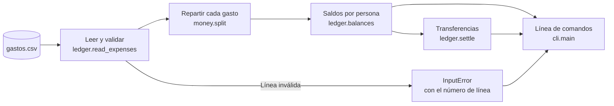

# 📋 Encargo · Dividir la cuenta

## La pregunta del dominio
> **Después de repartir, ¿la suma de lo que se debe es exactamente cero, sin un céntimo perdido ni inventado?**

La aplicación ya responde que sí. Tu trabajo es la otra mitad: **una suite que se dé cuenta el día en que deje de ser así.**

## Contexto
Un grupo de amigos comparte gastos: una cena, un viaje, un regalo. `splitbill` es una pequeña aplicación de línea de comandos que lee un archivo CSV con los gastos y dice **cuánto debe o recibe cada quien** y **qué transferencias hacer** para quedar a mano.

La aplicación funciona y está en [`reference/src/splitbill/`](reference/src/splitbill/). El equipo quiere empezar a cambiarla (monedas, repartos desiguales), pero no se atreve: no tiene pruebas. Te piden **la suite de pruebas unitarias** que les permita cambiar el código sin miedo. No cambias la aplicación: la pruebas.

## Dominio
| Concepto | Reglas |
|---|---|
| **Gasto** | Quién pagó (`payer`), cuánto (`amount`) y entre quiénes se reparte (`participants`). Quien paga puede no participar (por ejemplo, un regalo) |
| **Monto** | Positivo, con punto decimal y como máximo 2 decimales: `12`, `12.5`, `12.50`. Nada de comas, signos ni notación científica |
| **Reparto** | En partes iguales, **en céntimos**. Los céntimos que no se dividen exacto van uno por uno a los participantes **en orden alfabético**: 100,00 entre `ana`, `beto` y `caro` → 33,34 · 33,33 · 33,33 |
| **Saldo** | Lo que una persona pagó menos lo que le toca. Positivo: le deben. Negativo: debe. **La suma de todos los saldos es 0,00 exacto** |
| **Transferencia** | Quien debe le paga a quien le deben. El que más debe le paga primero al que más le deben; juntas llevan todos los saldos a cero, con como mucho (personas − 1) transferencias |



## Contrato
Esto es lo que la aplicación promete. Tus pruebas comprueban estas promesas.

**Entrada:** un archivo CSV en UTF-8 (también se acepta el UTF-8 con BOM que guarda Excel), con este encabezado exacto:

```text
payer,amount,participants
ana,90.00,ana;beto;caro
beto,30.00,beto;caro
```

Los participantes van separados por `;`. Los espacios alrededor de nombres y montos no cuentan, y las líneas en blanco se ignoran.

**Módulos:**

| Módulo | Funciones | Promete |
|---|---|---|
| [`money.py`](reference/src/splitbill/money.py) | `parse_amount(text)` | Un `Decimal` positivo; si el texto no cumple las reglas del monto → `ValueError` |
| | `split(amount, people)` | Partes en céntimos que suman exactamente `amount`, el céntimo sobrante a las primeras |
| | `format_amount(value)` | `+12.50` si le deben, `-12.50` si debe, `0.00` (sin signo) si está a mano |
| [`ledger.py`](reference/src/splitbill/ledger.py) | `read_expenses(lines)` | Lista de `Expense`; una línea inválida → `InputError` que empieza con `line N:` |
| | `balances(expenses)` | Saldo por persona, por nombre; suman exactamente 0 |
| | `settle(balance)` | Lista de `Transfer` que llevan todo a cero |
| [`cli.py`](reference/src/splitbill/cli.py) | `main(argv)` | Ver la tabla de comandos |

**Comandos** (lo que imprime `main`):

| Comando | Salida (stdout) | Código de salida |
|---|---|---|
| `balances <archivo>` | Una línea por persona, ordenadas por nombre: `ana +60.00`, `beto -15.00`, `caro -45.00` | 0 |
| `settle <archivo>` | Una línea por transferencia: `beto -> ana: 15.00` | 0 |
| Archivo inválido o inexistente | Nada en stdout; en **stderr**, un mensaje que empieza con `error:` (y nombra la línea, `line 3: …`, si es un error del contenido) | **2** |
| Comando desconocido | Nada en stdout; `argparse` termina el programa | **2** |

## Tu entregable
Una suite de **pruebas unitarias** en [`your-suite/tests/`](your-suite/tests/), que se corre desde [`your-suite/`](your-suite/) con `python -m pytest`. Ya trae la configuración que importa la aplicación desde `reference/src` y una primera prueba de ejemplo.

- **Unitarias:** llaman a las funciones y a `main(argv)` dentro del mismo proceso de Python. Correr la aplicación como un programa aparte es una prueba de aceptación, tema del bloque 3.
- **Por módulo:** un archivo por módulo (`test_money.py`, `test_ledger.py`, `test_cli.py`) es una buena organización, pero la estructura es tuya.

## Criterios de aceptación
El proyecto se acepta con una **caza de mutantes de toda la aplicación**: [`acceptance/test_suite_hunt.py`](acceptance/test_suite_hunt.py) corre tu suite contra la aplicación real (debe pasar) y contra 12 copias con un bug cada una (debe fallar con todas). Cada mutante es una promesa del contrato que tu suite tiene que proteger:

| Mutante | Si la aplicación hiciera esto… | Tu suite debe fallar |
|---|---|---|
| `m01-float-split` | Repartir con `float` y redondear cada parte | ✔️ |
| `m02-leftover-to-the-last` | Dar el céntimo sobrante a los **últimos** en vez de a los primeros | ✔️ |
| `m03-leftover-lost` | Olvidar el céntimo sobrante | ✔️ |
| `m04-three-decimals` | Aceptar montos con tres decimales | ✔️ |
| `m05-zero-accepted` | Aceptar un monto cero | ✔️ |
| `m06-file-order` | Repartir el céntimo según el orden del archivo, no el alfabético | ✔️ |
| `m07-alphabetical-debtor` | Que pague primero el deudor alfabético, no el que más debe | ✔️ |
| `m08-exit-code-1` | Terminar con código 1 (no 2) ante un error de entrada | ✔️ |
| `m09-error-on-stdout` | Escribir el error en stdout en vez de stderr | ✔️ |
| `m10-names-not-stripped` | No quitar los espacios alrededor de los nombres | ✔️ |
| `m11-no-bom` | No aceptar el archivo con BOM que guarda Excel | ✔️ |
| `m12-signed-zero` | Mostrar un saldo cero con signo (`+0.00`) | ✔️ |

## Requisitos de las pruebas (lo que aplica del bloque)
| Requisito | Aprendido en |
|---|---|
| Ver fallar cada prueba importante al menos una vez | [1.1](../01-what-is-a-test/CONCEPT.md) |
| `assert`, `pytest.raises` con `match`, y `Decimal` comparado exacto (no `approx`) | [1.2](../02-first-tests/README.md) |
| Casos por clase y en los límites (montos válidos e inválidos, céntimos que sobran), escritos como tablas con `parametrize` e IDs legibles | [1.3](../03-test-case-design/README.md) |
| Fixtures para lo que se repite, compartidas con `conftest.py` si las usan varios archivos | [1.4](../04-organize-suite/README.md) |
| Archivos de prueba en `tmp_path`, nunca en tu carpeta | [1.5](../05-test-doubles/README.md) |
| Cobertura de ramas revisada: ninguna rama de las reglas sin probar | [1.6](../06-coverage/README.md) |

## Lo nuevo de este proyecto
Tres herramientas que los labs no usaron y que la línea de comandos necesita.

### Capturar lo que se imprime (`capsys`)
`main()` responde imprimiendo: la salida normal en stdout y los errores en stderr. La fixture `capsys` de pytest captura las dos, y `capsys.readouterr()` devuelve lo impreso hasta ese momento, con `.out` y `.err` por separado:

```python
def test_greets(capsys):
    print("hola")
    assert capsys.readouterr().out == "hola\n"
```

### Una fixture que devuelve una función (*factory fixture*)
Cada prueba de la línea de comandos necesita un CSV distinto. Una fixture puede devolver una **función** que la prueba llama con sus propios datos:

```python
@pytest.fixture
def greeting_file(tmp_path):
    def write(text):
        path = tmp_path / "greeting.txt"
        path.write_text(text, encoding="utf-8")
        return path

    return write


def test_reads_the_greeting(greeting_file):
    path = greeting_file("hola")
    assert path.read_text(encoding="utf-8") == "hola"
```

### Un archivo como lo guarda Excel (BOM)
Excel guarda los CSV en UTF-8 con un **BOM** (*byte order mark*): tres bytes invisibles al inicio del archivo. Para escribir uno así en una prueba, usa la codificación `utf-8-sig`: `path.write_text(texto, encoding="utf-8-sig")`.

## Fijo y libre
- **Fijo:** la aplicación (no la cambies), Python 3.12+ y pytest. La caza solo mira si tu suite pasa con la aplicación real y falla con cada mutante.
- **Libre:** cuántas pruebas, cómo las organizas, sus nombres y sus fixtures.

## Fuera de alcance
- Correr `splitbill` como un programa aparte, por su línea de comandos real (eso es aceptación, bloque 3). Por eso `__main__.py` queda fuera de tu cobertura.
- Medir el rendimiento con archivos enormes.
- Cambiar o mejorar la aplicación. Si encuentras algo que harías distinto, anótalo para la retrospectiva.
