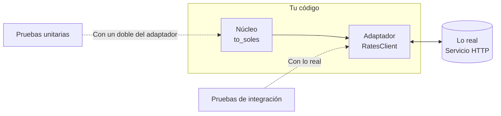

# 🧠 Qué cambia al integrar · Conceptos

## El problema
En el [lab 1.5](../../01-unit-tests/05-test-doubles/README.md) probaste `Library` con un mock del notificador, y la suite quedó en verde. Pero ninguna prueba mandó un correo: el mock solo anotó que `send` se llamó con `"ana"` y un mensaje. ¿Quién comprueba que el notificador **real** sabe hablar con el servidor de correo? Nadie. Las pruebas unitarias aíslan tu código de lo real a propósito, y por eso no pueden decir nada de lo real.

Mira un caso concreto. Una función convierte dólares a soles con la tasa que le da un cliente HTTP:

```python
class RatesClient:
    def rate(self, currency: str) -> Decimal:
        data = json.loads(self.fetch(f"/rates/{currency}"))
        return Decimal(data["rate"])


def to_soles(amount: Decimal, currency: str, rates: RatesClient) -> Decimal:
    return (amount * rates.rate(currency)).quantize(Decimal("0.01"))
```

La prueba unitaria reemplaza el cliente por un stub, como en el lab 1.5, y pasa:

```python
def test_converts_with_the_rate():
    rates = create_autospec(RatesClient, instance=True)
    rates.rate.return_value = Decimal("3.75")
    assert to_soles(Decimal("10"), "USD", rates) == Decimal("37.50")
```

Ahora el servicio de verdad responde `{"currency": "USD", "value": "3.75"}`: la clave se llama `value`, no `rate`. En producción, `to_soles` lanza `KeyError: 'rate'`. La prueba unitaria sigue en verde, porque el stub reemplazó justo la parte que estaba mal. El doble **repite lo que tú creías** sobre el servicio, y si lo que creías era falso, el doble miente con tu misma convicción.

## Una prueba de integración
Una **prueba de integración** (*integration test*) ejecuta tu código junto con algo real que no es tuyo: un archivo en disco, una base de datos, un servicio HTTP. Ya la conociste en el lab 1.1 como el nivel del medio de la pirámide. Lo que comprueba no es tu lógica (eso lo hacen las unitarias), sino **el encaje**: que tu código y lo real están de acuerdo en el formato, las reglas y los errores.

| Lo que puede fallar al encajar | Ejemplo | ¿Lo ve una prueba con un doble? |
|---|---|---|
| El formato | El servicio dice `value` y tu código lee `rate` | No: el doble responde lo que tú le dijiste |
| Las reglas de lo real | Una consulta SQL que la base rechaza, una columna con otro tipo | No: el doble no ejecuta SQL |
| El sistema operativo | Saltos de línea o codificación distintos en Windows y Linux | No: un doble no escribe en disco |
| Las fallas de verdad | Un servicio que tarda, responde 500 o no está | Solo las que imaginaste |

## El borde: dónde va cada tipo de prueba
Si cada prueba de integración es lenta, no quieres probar **todo** con lo real. La clave es separar el código en dos partes:

- **El núcleo:** tu lógica (`to_soles`, las reglas del préstamo). No habla con nada de afuera.
- **El borde** o **adaptador** (*adapter*): la pieza pequeña que traduce entre tu código y lo real (`RatesClient`, `LoanStore`). Lee el JSON, arma el SQL, abre el archivo.



Las pruebas unitarias prueban el núcleo con un doble del adaptador: son muchas y rápidas. Las pruebas de integración prueban **el adaptador contra lo real**: son pocas, y cada una revisa una forma en que el encaje puede fallar. Así el doble del núcleo deja de mentir sin control, porque otra prueba confirma lo que el doble supone. Es la recomendación del lab 1.5 vista desde el otro lado: «no hagas mock de lo que no es tuyo; envuélvelo en una clase tuya pequeña». Esa clase pequeña es el adaptador, y es la que se prueba con lo real.

## Real o doble: cómo decidir
No hay una respuesta única. Para cada dependencia, hazte estas preguntas:

| Pregunta | Si la respuesta es sí… |
|---|---|
| ¿Es barato tenerla de verdad en la prueba? (un archivo, SQLite en memoria) | Usa lo real, incluso en pruebas que no son del adaptador |
| ¿Es determinista? (da lo mismo cada vez) | Lo real sirve; si no lo es (la hora, el azar), usa un doble o fíjala |
| ¿Tiene efectos que no puedes deshacer? (cobrar, mandar un correo) | Doble en la suite; lo real, solo contra un entorno de prueba del proveedor |
| ¿Es tuyo y lo controlas? | Lo real, o un *fake* que mantienes tú |
| ¿Puedes levantar una copia local? (un servidor de prueba, un contenedor) | Prueba el adaptador contra esa copia |

Fíjate en la primera fila: «real» no significa «lento». Un archivo en una carpeta temporal o una base SQLite en memoria cuestan milisegundos, y a veces es más simple usarlos que escribir un doble.

## Aislar cuando lo real se comparte
Un doble nace y muere con la prueba. Lo real no: un archivo o una fila de una base de datos **siguen ahí** cuando la prueba termina. Si la prueba siguiente los encuentra, su resultado depende de qué corrió antes, y la suite deja de ser aislada y repetible (las propiedades del lab 1.1).

Cada prueba que usa algo real necesita dos pasos alrededor de su Arrange, Act, Assert:

- **Preparación** (*setup*): dejar lo real en un estado conocido. Crear la carpeta, crear las tablas, cargar los datos de prueba.
- **Limpieza** (*teardown*): devolverlo como estaba. Borrar lo creado, cerrar la conexión, deshacer los cambios.

Hay cuatro estrategias, y una suite suele combinarlas:

| Estrategia | Cómo | Cuándo conviene |
|---|---|---|
| **Uno nuevo por prueba** | Cada prueba recibe su propia carpeta o su propia base vacía | Cuando crearlo es barato (ya lo hiciste con `tmp_path` en el lab 1.5) |
| **Limpiar al terminar** | La prueba borra lo que creó | Cuando crearlo es caro y la limpieza es simple |
| **Deshacer al terminar** | Todo lo de la prueba ocurre en una transacción que al final se deshace (*rollback*) | Bases de datos: es rápido y no deja rastro |
| **Compartir solo lo que nadie modifica** | Un recurso creado una vez, de solo lectura | Datos de consulta, un servidor arrancado una vez (el `scope` del lab 1.4) |

La limpieza tiene una exigencia difícil: debe ocurrir **también cuando la prueba falla**. Una prueba que se cae en el Assert y nunca llega a su última línea no puede limpiar ahí. En el lab 2.3 verás cómo lo resuelve pytest.

## El costo de lo real
Las pruebas de integración pagan un precio, y conviene saberlo antes de escribirlas:

- **Son más lentas.** Abrir conexiones, escribir en disco o cruzar la red cuesta de milisegundos a segundos por prueba.
- **Pueden fallar por el entorno.** Un puerto ocupado, un servicio caído o un permiso de carpeta hacen fallar una prueba aunque tu código esté bien.
- **Dicen menos de dónde está el error.** Cuando una falla, el problema puede estar en tu adaptador, en la configuración o en lo real.

Por eso son pocas, enfocadas en el borde, y se pueden separar del resto con marcas (lab 1.4), por ejemplo para correr solo las rápidas mientras programas.

## Lo que viene en este bloque
| Lab | Lo real | Lo nuevo |
|---|---|---|
| [2.2](../02-real-files/README.md) | Archivos | Datos de prueba y archivos esperados; Windows frente a Linux |
| [2.3](../03-real-database/README.md) | Una base de datos SQLite | Preparar y limpiar con pytest; transacciones: todo o nada |
| [2.4](../04-http-service/README.md) | Un servicio HTTP | Un servidor de prueba local y sus fallas |
| [2.5](../05-containers/README.md) (electivo) | PostgreSQL en un contenedor | Lo que esconde probar con una base distinta a la de producción |
| 2.P | Las tres cosas juntas | La suite de integración de un importador de gastos |

## Fuentes
- [Martin Fowler · IntegrationTest](https://martinfowler.com/bliki/IntegrationTest.html): integración «angosta» (un adaptador contra lo real) frente a «amplia» (todo el sistema).
- [Ham Vocke · The Practical Test Pyramid](https://martinfowler.com/articles/practical-test-pyramid.html): en su sección «Integration Tests», una prueba de integración por cada borde de la aplicación.
- [Alistair Cockburn · Hexagonal architecture](https://alistair.cockburn.us/hexagonal-architecture/): el origen de los puertos y adaptadores.
- [pytest · How to use fixtures: teardown/cleanup](https://docs.pytest.org/en/stable/how-to/fixtures.html#teardown-cleanup-aka-fixture-finalization): la preparación y la limpieza en pytest, que verás en el lab 2.3.
