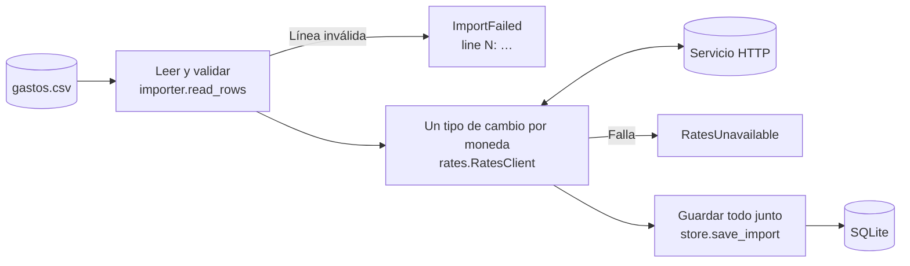

# 📋 Encargo · Importar gastos

## La pregunta del dominio
> **Si una importación falla a la mitad, ¿la base de datos queda exactamente como estaba, y el mismo archivo se puede volver a importar?**

La aplicación ya responde que sí. Tu trabajo es la otra mitad: **una suite de integración que se dé cuenta el día en que deje de ser así.**

## Contexto
Una persona registra los gastos de sus viajes en una planilla y la exporta como CSV, con montos en soles y en otras monedas. `expenses` lee ese archivo, convierte cada monto a soles (PEN) con un **servicio de tipos de cambio** por HTTP y guarda todo en una base **SQLite**, para sumar después cuánto gastó.

La aplicación funciona y está en [`reference/src/expenses/`](reference/src/expenses/). Sus tres piezas hablan con algo real: un archivo, una base de datos y un servicio. Las pruebas unitarias con dobles no pueden decir si encajan (lab [2.1](../01-what-changes/CONCEPT.md)). Te piden **la suite de integración**: cada pieza probada contra lo real, y el importador con las tres juntas. No cambias la aplicación: la pruebas.

## Dominio
| Concepto | Reglas |
|---|---|
| **Gasto** | Fecha, descripción, monto y moneda, tal como vienen en el archivo, más el monto convertido a soles |
| **Monto** | Positivo, con punto decimal y como máximo 2 decimales: `12`, `12.5`, `12.50` |
| **Moneda** | Tres letras mayúsculas (`USD`, `EUR`, `PEN`). Los soles (`PEN`) no se convierten |
| **Conversión** | Monto × tipo de cambio, redondeado al céntimo; **medio céntimo redondea hacia arriba**: 1,25 USD × 3,70 = 4,625 → **4,63** |
| **Importación** | Todo o nada: si una línea es inválida o el servicio falla, **no se guarda ningún gasto** y el archivo se puede importar de nuevo cuando se arregle |
| **Duplicado** | Un archivo con **exactamente el mismo contenido** que otro ya importado se rechaza, aunque tenga otro nombre |



## Contrato

**Archivo de entrada:** CSV en UTF-8, con este encabezado exacto. Las líneas en blanco se ignoran y los espacios alrededor de cada campo no cuentan:

```text
date,description,amount,currency
2026-11-02,Hotel en Cusco,32.00,USD
2026-11-02,Café y pan,18.50,PEN
```

**Servicio de tipos de cambio:**

| Petición | Respuesta |
|---|---|
| `GET /v1/rates/USD` | 200 con `{"currency": "USD", "rate_to_pen": "3.70"}` (el tipo de cambio viene como texto, para no perder decimales) |
| Moneda desconocida | 404 |
| Cualquier otro error, más lento que el `timeout` o sin conexión | La aplicación lo trata como «no disponible» |

**Módulos:**

| Módulo | Promete |
|---|---|
| [`rates.py`](reference/src/expenses/rates.py) · `RatesClient(base_url, timeout=2.0)` | `rate_to_pen(currency)` devuelve el tipo de cambio como `Decimal` exacto. Un 404 → `UnknownCurrency`; cualquier otro error, un `timeout` o un servicio caído → `RatesUnavailable` |
| [`store.py`](reference/src/expenses/store.py) · `ExpenseStore(conn)` | Crea sus tablas en la conexión que recibe. `save_import(fingerprint, file_name, expenses)` guarda la importación y sus gastos en **una sola transacción, confirmada**. `expenses()` los devuelve en el orden en que se guardaron, con los `Decimal` exactos. `total_pen()` suma exacto al céntimo. `was_imported(fingerprint)` dice si ya se importó |
| [`importer.py`](reference/src/expenses/importer.py) · `import_file(path, store, rates)` | Importa el archivo y devuelve cuántos gastos guardó. Pide **un solo tipo de cambio por moneda**, aunque la moneda aparezca en varias líneas, y ninguno para `PEN`. Una línea inválida → `ImportFailed` con un mensaje que empieza con `line N:`. Un error del servicio sale tal cual (`RatesUnavailable`, `UnknownCurrency`). Un archivo repetido → `DuplicateImport` |

## Tu entregable
Una suite de **pruebas de integración** en [`your-suite/tests/`](your-suite/tests/), que se corre desde [`your-suite/`](your-suite/) con `python -m pytest`. Ya trae la configuración que importa la aplicación desde `reference/src`, la fixture `httpserver_listen_address` del lab 2.4 en su `conftest.py`, y una primera prueba de ejemplo.

- **Contra lo real:** archivos de verdad (en `tmp_path` o junto a tus pruebas), SQLite de verdad y un servidor HTTP de verdad con `pytest-httpserver`. Ningún mock de `requests` ni de la base.
- **Por módulo:** un archivo por pieza (`test_rates.py`, `test_store.py`, `test_importer.py`) es una buena organización, pero la estructura es tuya.

## Criterios de aceptación
El proyecto se acepta con una **caza de mutantes de toda la aplicación**, como en el [proyecto 1.P](../../01-unit-tests/project-split-bill/BRIEF.md#criterios-de-aceptación): [`acceptance/test_suite_hunt.py`](acceptance/test_suite_hunt.py) corre tu suite contra la aplicación real (debe pasar) y contra 13 copias con un bug cada una (debe fallar con todas):

| Mutante | Si la aplicación hiciera esto… | Tu suite debe fallar |
|---|---|---|
| `m01-rounds-half-even` | Redondear el medio céntimo al par más cercano (4,625 → 4,62) | ✔️ |
| `m02-request-per-row` | Pedir el tipo de cambio una vez por línea, no por moneda | ✔️ |
| `m03-asks-rate-for-pen` | Pedirle al servicio el tipo de cambio de los soles | ✔️ |
| `m04-unknown-currency-is-unavailable` | Tratar el 404 como «no disponible» | ✔️ |
| `m05-saves-as-it-reads` | Guardar cada gasto apenas lee su línea | ✔️ |
| `m06-saves-as-it-converts` | Validar todo, pero guardar cada gasto apenas tiene su tipo de cambio | ✔️ |
| `m07-duplicate-by-name` | Reconocer un duplicado por el nombre del archivo, no por su contenido | ✔️ |
| `m08-import-recorded-first` | Anotar la importación antes de pedir los tipos de cambio | ✔️ |
| `m09-total-in-sql` | Sumar el total con `SUM` en SQL | ✔️ |
| `m10-no-timeout` | Pedir el tipo de cambio sin `timeout` | ✔️ |
| `m11-line-number-off` | Contar las líneas sin el encabezado | ✔️ |
| `m12-reads-latin-1` | Leer el archivo como Latin-1 en vez de UTF-8 | ✔️ |
| `m13-never-commits` | Guardar sin confirmar la transacción | ✔️ |

## Requisitos de las pruebas (lo que aplica del bloque)
| Requisito | Aprendido en |
|---|---|
| Probar cada adaptador contra lo real, y el núcleo con lo real cuando es barato | [2.1](../01-what-changes/CONCEPT.md) |
| Un CSV de ejemplo junto a las pruebas, encontrado con `Path(__file__).parent`, y archivos de cada prueba en `tmp_path` | [2.2](../02-real-files/README.md) |
| Una base SQLite nueva por prueba con una fixture con `yield`; datos sembrados conocidos | [2.3](../03-real-database/README.md) |
| Después de cada error, comprobar **el estado de la base**, no solo la excepción | [2.3](../03-real-database/README.md) |
| Un servidor de prueba local con expectativas, errores HTTP, `Delay` y un puerto cerrado | [2.4](../04-http-service/README.md) |
| Fixtures compartidas en `conftest.py`, y una fixture que devuelve una función para escribir cada CSV | [1.4](../../01-unit-tests/04-organize-suite/README.md) y [1.P](../../01-unit-tests/project-split-bill/BRIEF.md#lo-nuevo-de-este-proyecto) |
| `Decimal` comparado exacto, nunca con `approx` | [1.2](../../01-unit-tests/02-first-tests/README.md) |

## Lo nuevo de este proyecto
Tres herramientas que los labs no usaron.

### Contar las peticiones que recibió el servidor (`httpserver.log`)
`httpserver.log` es la lista de todas las peticiones que recibió el servidor de prueba en esta prueba, cada una con su respuesta. Sirve para comprobar **cuántas veces** te llamó el cliente:

```python
def test_asks_once(httpserver):
    httpserver.expect_request("/ping").respond_with_data("pong")
    requests.get(httpserver.url_for("/ping"), timeout=2)
    assert len(httpserver.log) == 1
```

### Una respuesta que vale una sola vez (`expect_oneshot_request`)
Para probar «falla y después funciona», `expect_oneshot_request` registra una respuesta que el servidor usa **una vez** y después descarta. Las respuestas de un solo uso se buscan antes que las de `expect_request`:

```python
httpserver.expect_oneshot_request("/ping").respond_with_data("busy", status=503)  # la primera vez
httpserver.expect_request("/ping").respond_with_data("pong")                      # las siguientes
```

### Cerrar no es confirmar
En `sqlite3`, `conn.close()` **no confirma** lo pendiente: lo que no se confirmó con `commit()` (o con `with conn:`) se pierde al cerrar. Una base `:memory:` y una sola conexión no lo muestran, porque la misma conexión ve sus propios cambios sin confirmar. Para comprobar que algo quedó guardado de verdad, usa una base en un archivo de `tmp_path`, cierra la conexión y ábrela de nuevo.

## Fijo y libre
- **Fijo:** la aplicación (no la cambies), Python 3.12+, pytest y pytest-httpserver. La caza solo mira si tu suite pasa con la aplicación real y falla con cada mutante.
- **Libre:** cuántas pruebas, cómo las organizas, sus nombres, sus fixtures y sus datos.

## Fuera de alcance
- Una línea de comandos y probar la aplicación como un programa aparte (aceptación, bloque 3).
- El servicio de tipos de cambio real: el contrato de arriba es lo que importa, y tu servidor de prueba lo cumple.
- PostgreSQL: si hiciste el electivo [2.5](../05-containers/README.md), en la 🔁 Retrospectiva del README hay una pregunta sobre eso.
